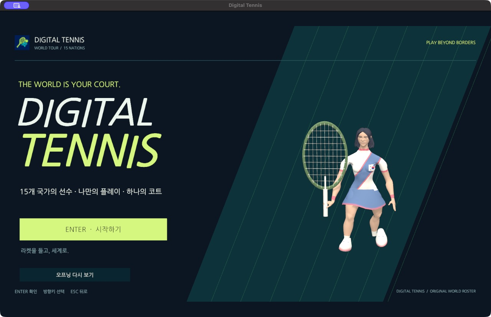
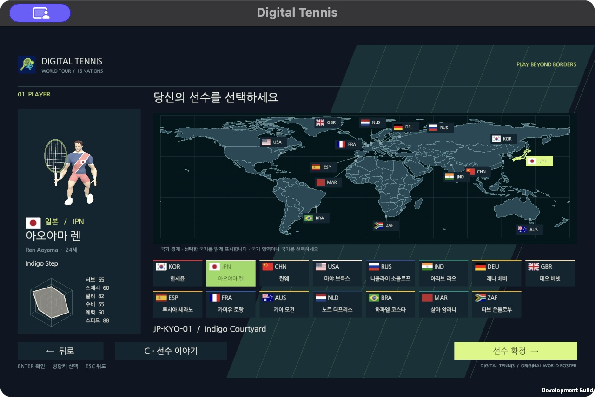
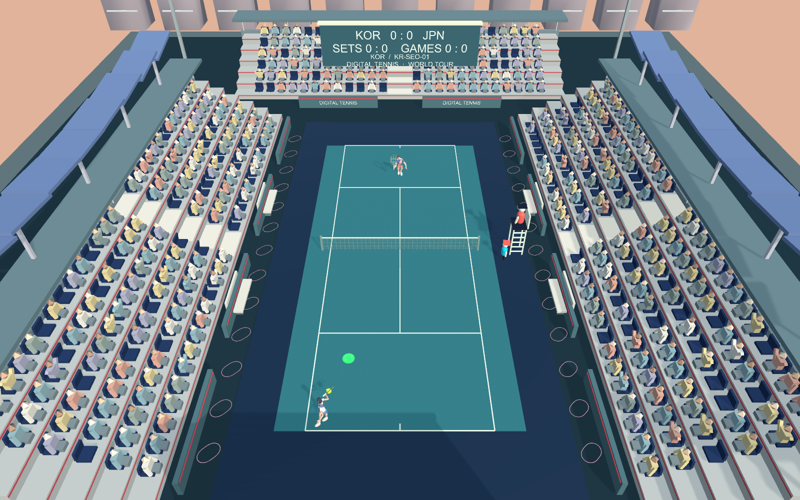

# Digital Tennis

**스윙 타이밍에 집중하는 PC 테니스 게임.** 세계지도에서 선수를 고르고, AI 또는 온라인 상대와 서브부터 매치 포인트까지 겨룹니다.

[시작하기](#시작하기) · [조작 방법](#조작-방법) · [온라인 대전](#온라인-대전) · [개발 문서](docs/README.md) · [기여하기](CONTRIBUTING.md)



## 어떤 게임인가요?

선수의 코트 이동은 자동으로 처리하고, 플레이어는 타격 시점과 샷 선택에 집중합니다. **키보드만으로 1인 플레이를 시작할 수 있습니다.** 별도로 개발하는 BLE 라켓 컨트롤러도 같은 입력 경계에 연결하는 구조입니다.

- **1인 플레이:** 하·중·상 난이도의 AI와 대결합니다.
- **온라인 2인 플레이:** 6자리 방 코드로 만나고, WebRTC 직접 연결 또는 WebSocket 릴레이로 경기합니다.
- **테니스 경기 진행:** 서브, 폴트·렛, 랠리, 듀스·어드밴티지, 게임·세트·타이브레이크와 최종 승패를 처리합니다. 기본은 3세트 중 2세트 선승입니다.
- **15명의 오리지널 선수:** 국가별 페르소나, 의상, 코트, 고유 스킬과 대사를 제공합니다. 스킬 사용권은 최대 3개까지 모을 수 있습니다.
- **경기 연출:** 타격·이동 효과음, 득점 환호, 관중석, 파티클과 스킬 연출을 적용합니다. 경기 중 BGM은 음소거합니다.
- **CSV 밸런스:** 선수 능력치와 샷·물리·AI·경기 규칙을 외부 CSV로 조정합니다.

| 세계지도에서 선수 선택 | 코트에서 랠리 |
| --- | --- |
|  |  |

화면은 실제 게임 실행 캡처입니다. [캡처 출처](docs/screenshots/README.md)를 확인할 수 있습니다.

## 시작하기

### 준비 환경

| 항목 | 기준 |
| --- | --- |
| Unity Editor | **6000.3.26f1**, Unity Hub로 설치 |
| 렌더링·스크립팅 | Built-in Render Pipeline · Mono |
| 개발·실행 대상 | macOS / Windows 데스크톱 |
| 추가 빌드 도구 | 컨트롤러 네이티브 모듈용 macOS Command Line Tools/Swift, Windows 모듈용 .NET 10 SDK |

Windows 빌드는 Unity Hub에서 Windows Build Support (Mono)도 설치합니다. macOS Apple Silicon에서는 ARM64 Editor를 사용합니다.

### Editor에서 플레이

```sh
git clone https://github.com/digital-tennis/digital-tennis-game.git
cd digital-tennis-game
```

1. Unity Hub의 **Add project from disk**에서 저장소 루트를 선택합니다.
2. 패키지 가져오기가 끝나면 `Assets/Scenes/FrontEnd.unity`를 엽니다.
3. **Play → 1인 플레이 → 선수·상대·코트 선택** 순서로 진행합니다.
4. 서브 대기에서 **Space**, 공이 타격 범위에 들어오면 **Q / W**를 누릅니다.

BLE 장비 없이도 이 경로로 플레이할 수 있습니다. 외부 패키지 참조는 `Packages/manifest.json`과 잠금 파일에서 Git 커밋으로 고정합니다.

## 조작 방법

아래는 기본 키입니다. 저장한 키 배치는 **설정 → 입력 컨트롤러 → 키보드**와 경기 화면의 안내를 확인하세요.

| 동작 | 기본 입력 |
| --- | --- |
| 메뉴 이동·선택·돌아가기 | 방향키 · Enter · Esc / 마우스 클릭 |
| 서브 | Space |
| 포핸드 / 백핸드 | Q / W |
| 스매시 / 발리 | S / V |
| 슬라이스 / 로브 | X / B |
| 고유 스킬 | K — 사용권이 있을 때 |

선수는 자동으로 공을 따라 이동합니다. 키 입력은 스윙 시도이며, 실제 타격은 공과의 거리·높이·경기 상태를 통과해야 합니다.

## 온라인 대전

1. [매칭 서버](https://github.com/digital-tennis/digital-tennis-match-server)의 빠른 시작에 따라 서버를 실행합니다.
2. 게임 두 개에서 **온라인**을 열고 같은 서버 주소를 지정합니다. 같은 Mac에서는 `ws://127.0.0.1:8080/ws`를 사용합니다.
3. 첫 게임에서 방을 만들고, 다른 게임에서 표시된 **6자리 코드**로 입장합니다.
4. 연결된 전송 방식과 서브 차례를 확인한 뒤 경기합니다. 양쪽 모두 자신의 선수가 화면 아래에 보입니다.

서로 다른 PC에서는 접속 가능한 서버 주소가 필요하며, 인터넷 운영은 `wss://`를 사용합니다. 직접 연결이 어려우면 릴레이로 전환합니다. 공·점수·승패는 호스트가 판정합니다. [연결·재접속 구조](docs/input-adapter-online.md)를 참고하세요.

## 무선 라켓 컨트롤러

제품 목표는 **NU40-DK에 별도 외장 IMU를 부착한 컨트롤러**입니다. 펌웨어가 센서를 보정하고6종 물리 회전/버튼Down·Up을 보내며, BLE SDK는 중립 이벤트로 전달하고 게임이 테니스 의미를 결정합니다. [입력 구조와 v3 호환](docs/physical-controller-input.md)을 참고하세요.

설정의 **무선 컨트롤러** 상세에서 `기기 찾기 → 연결·OS 본딩 → 통신 확인 → 센서 보정·동작 테스트 → 저장` 순서로 설정합니다. 키보드 설정은 별도의 메뉴이며 연결 절차를 요구하지 않습니다.

Mac 일반 게임 창에서 센서 없는 NU-54의 암호화·본딩, 실제 테니스 메시지 왕복과 보드 재시작 후 재연결을 확인했습니다. NU40-DK 실물·외장 IMU와 Windows 검증은 남아 있습니다. [현재 지원·검증 범위](docs/controller-bonding.md) · [설정 흐름](docs/controller-setup-flow.md)

## 밸런스 조정

기본 CSV는 `Assets/StreamingAssets/Balance/`에 있습니다. 게임은 사용자 저장 폴더에 복사한 외부 파일을 사용하므로, 설정에 표시되는 파일을 수정한 뒤 안전한 서브 대기에서 **F5**로 다시 읽을 수 있습니다. 잘못된 파일은 거부하고 이전 값을 유지합니다. 경기 규칙 변경은 다음 경기에 적용합니다.

[CSV 항목과 적용 방법](docs/gameplay-balance.md) · [점수·세트·타이브레이크 규칙](docs/match-rules.md)

## 개발·빌드

같은 프로젝트가 열린 Editor에서 작업을 저장하고 닫은 뒤 실행합니다. Editor가 기본 경로에 없다면 `UNITY_EDITOR_PATH`를 지정합니다.

```sh
bash tools/unity.sh check
bash tools/unity.sh test-edit
bash tools/unity.sh test-play
bash tools/unity.sh build-mac
open Builds/mac/DigitalTennis.app
```

Windows는 `build-windows`를 사용하며 결과는 `Builds/windows/DigitalTennis.exe`입니다. 배포 옵션은 `release-mac` / `release-windows`입니다. 패키징·추가 검사는 [개발 안내](docs/development.md)를 따릅니다. 생성한 `Library/`, `Builds/`, `.work/`는 커밋하지 않습니다.

## 프로젝트 구성

| 경로 | 내용 |
| --- | --- |
| `Assets/Scenes/` | 시작 화면과 경기 씬 |
| `Assets/Scripts/` | 경기 규칙·입력·온라인·화면 표현 |
| `Assets/StreamingAssets/` | 외부에서 읽는 밸런스·효과·음향 데이터 |
| `Packages/`, `ProjectSettings/` | 고정 패키지와 Unity 공통 설정 |
| `docs/`, `tools/` | 사용·개발 문서와 재현 도구 |

게임 외의 기능은 [AI](https://github.com/digital-tennis/digital-tennis-ai), [컨트롤러 SDK](https://github.com/digital-tennis/digital-tennis-ble-unity), [프로토콜](https://github.com/digital-tennis/digital-tennis-protocol), [펌웨어](https://github.com/digital-tennis/digital-tennis-firmware), [매칭 서버](https://github.com/digital-tennis/digital-tennis-match-server)로 분리합니다. [전체 구조와 개발 과제](https://github.com/digital-tennis/digital-tennis-docs)를 함께 확인하세요.

## 도움말·기여

[Digital Tennis](https://github.com/digital-tennis)가 관리합니다. 버그는 [Issues](https://github.com/digital-tennis/digital-tennis-game/issues)에 OS·게임 버전/커밋·재현 순서·기대 결과를 남겨 주세요. 코드와 자산을 제안할 때는 [기여 안내](CONTRIBUTING.md)를 따릅니다. 화면·캐릭터·음향·검증 문서는 [문서 목차](docs/README.md)에서 찾을 수 있습니다.

## 라이선스

직접 작성한 코드·문서는 [Apache-2.0](LICENSE)입니다. 재배포 시 [NOTICE](NOTICE)를 포함하세요. 모델·폰트·국기·지도·음원과 런타임의 개별 조건·출처는 [외부 자산 고지](THIRD_PARTY_NOTICES.md)에 정리합니다.

### NU-54 실제 버튼 컨트롤러

[실물 버튼 검수 화면과 결과](docs/nu54-buttons.md)

무선 설정에서 NU-54를 연결하면 현재 본딩 연결의 프로필 응답으로 버튼 모드를 확인합니다. 구형 v2는 SW1=서브, SW2=포핸드, SW3=백핸드, SW4=스킬을 보냅니다. 새 v3는 버튼1~4의 Down/Up을 보내고, 게임의 기본 바인딩이 1=서브 대기의 기본 동작, 2/3=횡회전 +/−, 4=스킬 요청으로 해석합니다. 어느 버전도 NU54에서 IMU를 사용하지 않습니다. 테스트 시작 후 세 액션을 확인하고 ‘저장하고 사용’을 눌러야 경기 입력이 바뀝니다. 타격은 실제 공의 거리·타이밍, 스킬은 실제 충전한 재고가 있어야 유효합니다. 게임의 CSV 기본 세기를 사용하며 키보드로 몰래 대체하지 않습니다. NU40-DK+별도 외장 IMU의 보정·검증은 별도입니다.
