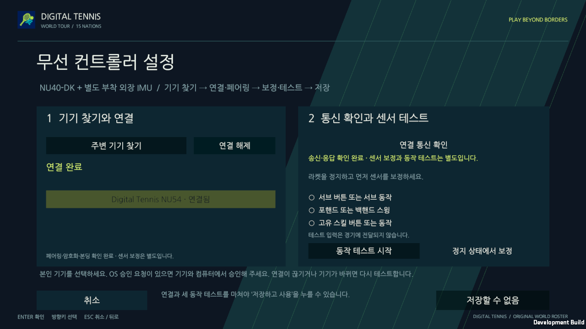

# 실제 컨트롤러 본딩·메시지 검수

2026-10-19, 검토 브랜치. **Mac 일반 Unity 창에서 실제 NU-54의 암호화·본딩, 테니스 메시지 왕복, 보드 재시작 후 본딩 재사용을 확인했습니다.** 제품 타깃은 NU40-DK+별도 외장 IMU이며 NU-54는 센서 없는 BLE 시험용입니다.

## 확인한 결과

| 절차 | 결과 | 근거 |
| --- | --- | --- |
| 시작 메뉴 → 설정 → 무선 상세 → 실제 기기 검색 | 실제 Tennis 서비스 기기 발견 | 일반 키보드 입력·실제 native backend |
| 기기 선택·연결 | 현재 상대의 암호화·본딩 확인 후 Connected | [연결 화면](evidence/ble-bonding-2026-10-19/connected.png) |
| 연결 통신 확인 | 20바이트 LINK_PROBE에 같은 연결·nonce의 LINK_REPLY 수신 | [왕복 화면](evidence/ble-bonding-2026-10-19/link-roundtrip.png) |
| 센서 없는 보정 요청 | 실패 응답, 보정·세 동작 테스트·저장 차단 | [미준비 화면](evidence/ble-bonding-2026-10-19/sensor-not-ready.png) |
| 보드 일반 재시작 | 연결·통신 확인 초기화 후 저장된 본딩으로 재연결 | [단절 상태](evidence/ble-bonding-2026-10-19/disconnected-after-reset.json) · [재연결 상태](evidence/ble-bonding-2026-10-19/reconnected-after-reset.json) |
| 재시작 후 통신 확인 | 새 요청·응답 성공, 센서 미준비와 저장 차단 유지 | [최종 화면](evidence/ble-bonding-2026-10-19/after-board-reset.png) |
| 무선 설정 취소 | 기존 Keyboard 선택 유지, 경기 입력·득점·타격 0 | [취소 상태](evidence/ble-bonding-2026-10-19/cancelled.json) |

## 실행 기준

Unity **6000.3.26f1**, Built-in/Mono, Mac 일반 창에서 검수했습니다. 최종 검증 빌드는 소스 `bf86e40147d1acee1a03e1139494759054ab0317`의 **깨끗한 작업 사본**으로 생성했습니다. 개발·디버깅 옵션이 켜진 검수용이며 배포 ZIP과 구분합니다. [빌드·복사 해시](evidence/ble-bonding-2026-10-19/build-proof.json)를 남겼습니다.

실제 키보드로 메뉴를 조작했고 `-dt-input-observe`는 화면·상태를 수동 관찰하기만 했습니다. 가짜 기기, 모의 전송, UI callback 직접 실행, 보정·저장 게이트 우회는 사용하지 않았습니다. 게임 카메라·Canvas의 원본 PNG와 JSON을 함께 보관했습니다. UI 도구의 마우스 좌표가 맞지 않아 이 검수의 조작은 키보드로 진행했습니다.

첫 clean 빌드 검색은 0기기였고 사용자가 누르는 것과 같은 명시적 재검색에서 실제 기기를 발견했습니다. 이를 첫 검색부터 항상 성공한 결과로 표시하지 않습니다. 최종 일반 창의 실행·파싱 예외는 0건입니다.

## 보안·메시지 근거

게임은 현재 연결 상대의 보호된 4바이트 상태를 확인해야 Connected로 전환합니다. 별도 native 진단에서도 **Security Level 2, bonded=true, Secure Connections=true**와 실제 LINK_REPLY를 확인했습니다. 해당 요청의 왕복은 **52.131ms**였으며 한 번의 측정값이지 성능 보장값은 아닙니다. `sensorReady=false`, `calibrated=false`도 유지됐습니다. [개인 식별자를 제외한 native 결과](evidence/ble-bonding-2026-10-19/native-bond-proof.json)

macOS Bluetooth 설정에서도 알려진 Tennis 기기가 연결됨으로 표시됐습니다. 이번 성공 실행 중 새로운 PIN·숫자 대조 팝업은 나타나지 않았습니다. **OS 키 저장소를 직접 검사하거나 새 승인 팝업을 조작한 성공으로 기록하지 않습니다.** 현재 화면 없는 시험 정책은 승인된 LE Secure Connections + Just Works이며 PIN/숫자 대조에 의한 최초 페어링 중간자 방어는 없습니다.

보드는 일반 reset만 수행했습니다. 펌웨어 재설치, 플래시 삭제, 본딩·기존 앱 저장영역 읽기/초기화 없이 실행 상태 복귀와 본딩 재사용을 확인했습니다. 검수 종료 후 임시 교체한 앱을 원래 백업으로 복원했고, 시험 기기의 본딩은 유지했습니다. [재시작 기록](evidence/ble-bonding-2026-10-19/board-reset.json)

## 이전 실패와 이번 결과의 구분

이전 시도는 인증 등급 불일치, ATT15·SMP timeout, 잠금 상태와 일부 검색 0기기 결과를 남겼습니다. 독립 Mono 검색 성공을 Unity 연결 성공으로 간주하지 않았습니다. 이번에는 잠금 해제 후 **깨끗한 새 Unity 빌드의 일반 창**에서 연결·왕복·재시작까지 직접 확인해 해당 미검증을 해소했습니다. 과거 실패 기록은 전체 문서의 이력으로 보존합니다.

기존 소프트웨어 근거는 protocol 이벤트 2,045·보안 66,046사례, SDK 44개, firmware 호스트 2모음과 보드 3구성, Unity Edit 189·Play 43통과/Null GPU 1제외·별도 GPU 마우스 1·패킷 장면 1입니다. 이 자동 검사와 위 실물 결과는 별도입니다. 이번 후속 변경은 검수 자료·지원 상태 문서이며 런타임 동작은 수정하지 않았습니다.

## 남은 검증

- NU40-DK 실물 GPIO·BLE와 별도 외장 IMU의 모델·배선·장착 축·보정·제스처 정확도
- 물리 Windows PC와 두 물리 PC/WAN
- 본딩이 없는 새 PC의 최초 OS 승인 팝업 조작

이번 센서 없는 통신 성공은 라켓 모션 인식이나 센서 입력으로 경기한 증거가 아닙니다. 원래 12일·3명 계획과 제품별 책임 분리는 유지합니다. [기계 판독 결과와 원본 해시](evidence/ble-bonding-2026-10-19/validation.json) · [전체 아키텍처](https://github.com/digital-tennis/digital-tennis-docs/blob/main/docs/project/architecture.md)
