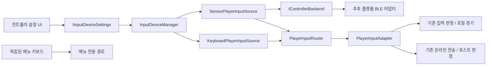
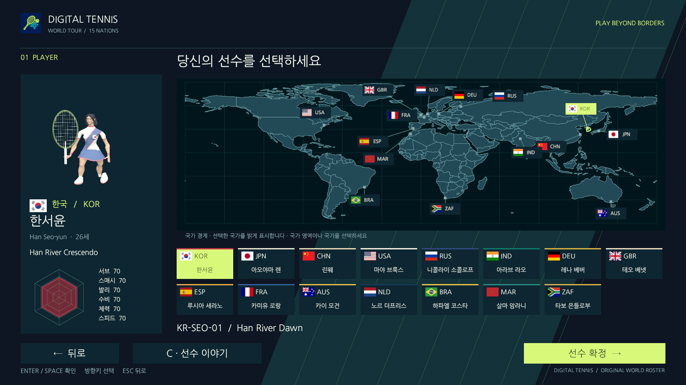
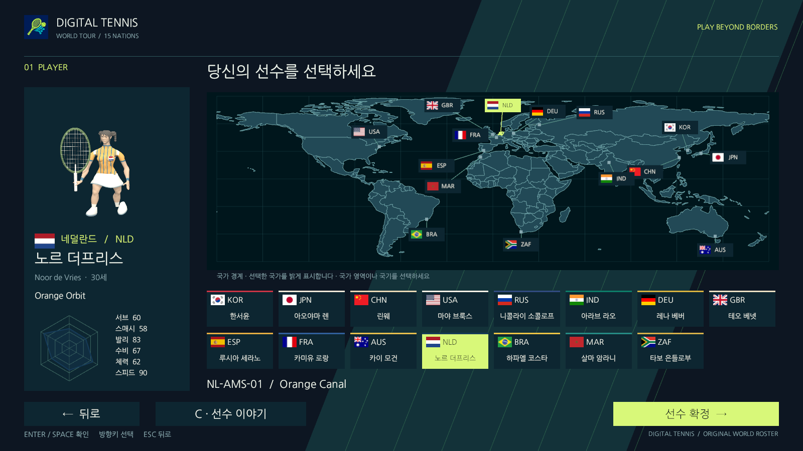
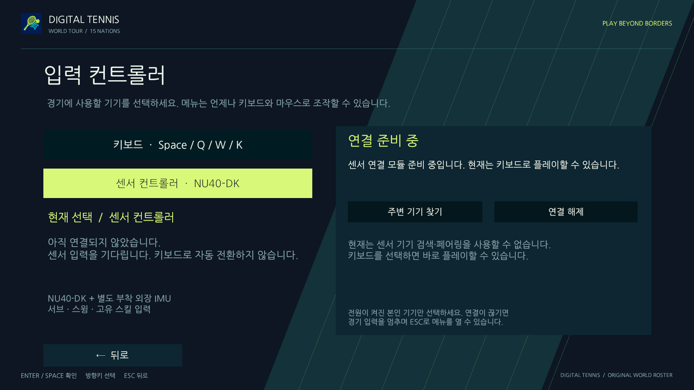

# 국기·국경 지도와 입력 컨트롤러 설정

이번 범위는 15명 선수의 국가 표시와 기기 선택/입력 경계를 개선한다. 이전 배포·음향 고도화와 실물 외장 IMU/BLE 구현은 이번 작업에 포함하지 않는다. NU40-DK에 외장 IMU를 별도로 부착하는 기존 전제는 유지한다.

## 사용자 화면

**입력 설정의 현재 사용자 흐름은 [기기별 상세 편집·테스트·저장](controller-setup-flow.md)으로 수정했다. 아래 PR #21 기록의 즉시 선택 UI는 교체했으며, 국가 자산·입력 경계·기존 검증 이력은 유지한다.**

- 선수 유니폼 앞가슴, 선수·상대·코트 선택 카드와 지도 마커, 대진 소개 및 경기 HUD에 15개 국가의 국기를 표시한다. 유니폼은 기존 스키닝 표면에 인쇄하며 별도 충돌체나 떠 있는 패치를 만들지 않는다.
- 지도에는 Natural Earth의 국가 외곽/내부 경계가 추가된다. 현재 선택 국가의 경계는 밝게 강조하고, 로스터에 있는 국가 영역을 직접 클릭하거나 국기 마커·하단 선수 카드로 선택한다. 바다와 로스터에 없는 국가는 선택을 바꾸지 않는다. 기존 도시 마커·키보드 선택을 유지한다.
- **설정 → 입력 컨트롤러**에서 키보드/무선 컨트롤러의 상세 화면을 연다. 목록에는 연결 패널을 섞지 않으며, 키보드 상세에는 키 배치·입력 테스트만 둔다.
- 무선 상세는 검색·목록·연결 요청·페어링 승인 대기·연결 완료·입력 테스트를 구별한다. 현재 실제 BLE 모듈이 없으므로 정상 사용자 화면에서는 기능 부재를 안내하고 검색/테스트/저장을 비활성화한다.
- 상세 편집은 임시 값이다. ‘저장하고 사용’이 파일 쓰기에 성공한 뒤에만 사용 기기/키 배치를 적용하고 원래 Options/Pause로 돌아간다. 취소는 임시 값을 버리고 기기 목록으로 돌아간다. 무선은 현재 연결에서 서브·스윙·스킬 테스트를 통과해야 저장할 수 있다.
- 저장된 무선 기기가 끊기면 경기 입력을 받지 않고 키보드로 자동 전환하지 않는다. 메뉴 키보드로 돌아가 키보드를 명시적으로 저장할 수 있다. 무선 선택 시 HUD 서브/스킬 버튼도 우회 입력을 만들지 않는다.
- 저장 형식은 사용자 폴더 `input-controller.json` 버전 2이며 사용 기기·키 배치·무선 기기 ID를 저장한다. v1은 기본 키 배치로 읽으며 기기 ID 없는 센서 선택을 Ready로 처리하지 않는다. batch 검증은 메모리 설정, 일반 창의 검증 전용 번들은 별도 `ControllerValidation` 파일을 사용해 실제 사용자 설정을 변경하지 않는다.

## 입력 구조와 패턴



소스 교체는 Strategy, 플랫폼 연결은 Adapter/Port, 임시 편집과 저장된 설정은 별도 객체로 분리한다. `ControllerSetupSession`은 파일/경기에 적용하지 않는 초안이며 `SaveSetup` 성공 후에만 소스를 교체한다. UI는 `IInputDeviceSettings`에 의존하며 BLE SDK를 참조하지 않는다. 테니스 판정은 기기 종류나 SDK를 알 필요 없이 기존 정규화 샘플만 받는다. 구현 조립 지점은 `ControllerBackendFactory.Create` 또는 명시적 `PlayerInputAdapter.ConfigureDevices`다. 기본 factory는 기능 부재를 보고하는 `UnavailableControllerBackend`를 생성한다.

설정 저장 성공/연결 상태가 바뀌면 이전 소스와 새 소스의 대기열을 비우고 라우터의 입력 네임스페이스를 바꾼다. 센서 선택 시 키보드 경기 소스는 폴링하지 않는다. 메뉴 키보드는 별도 경로이며 라켓 동작을 내보내지 않는다. 센서 스윙은 메뉴에서 확인 버튼으로 해석하지 않는다. 기존 CLI 검증은 명시적 `UseSource` 주입 경계를 유지하고 정상 사용자 설정 UI에서는 임의 소스를 설치하지 않는다.

## 향후 BLE 구현 계약

`IControllerBackend`를 구현하는 플랫폼 모듈만 추가한다. OS 페어링 승인·검색/연결의 비동기 작업·취소·패킷 디코딩은 모듈 책임이다. `Tick`에서 Unity 스레드용 상태 스냅샷을 게시하고 늦게 도착한 취소 작업 결과를 폐기해야 한다. UI나 매치에 플랫폼 API를 넣지 않는다.

`ControllerEvent`에는 허용된 라켓 의도, 시퀀스, 정규화 세기/방향과 **PC의 단조 시계로 측정한 수신 시각**만 사용한다. IMU 내부 시계를 PC 수신 시각처럼 취급하거나, 대기열을 나중에 읽는 시각으로 오래된 이벤트를 새로 포장하지 않는다. `ConnectionEpoch`는 PC 연결 단위로 새로 발급하며 보드의 플레이어 역할이나 Near/Far 값을 받지 않는다. 재연결마다 epoch를 바꾸고, `Disconnect`는 검색/연결 worker 콜백까지 취소하며, `ClearInput`은 모션 전달과 대기 입력만 비운다. 라우터의 중복·오래된/미래·NaN/범위 검사와 기존 타격 범위/높이/차례/스킬 검사는 유지된다.

온라인에서도 같은 경로를 사용한다. 로컬 역할을 host/guest에 매핑하는 기존 세션이 전송하고, 공/점수/스킬은 계속 호스트만 결정한다. 센서 연결 끊김은 로컬 경기 입력만 중단하며 온라인 상대나 물리를 임의로 일시 정지시키지 않는다.

## 원본과 라이선스

국기는 [flag-icons](https://github.com/lipis/flag-icons)의 4:3 SVG 15개를 512×384 PNG로 변환했다. 원본과 MIT 원문을 `Assets/ThirdParty/Selection/FlagIcons`에 보관한다. 맵은 [Natural Earth](https://www.naturalearthdata.com/about/terms-of-use/) 공개 도메인 110m Admin 0 국가 GeoJSON의 모든 링을 기존 지도 투영에 맞췄다. 개별 국가의 단순화된 도형은 게임 선택 지도용이다. 원본 URL·고정 리비전·원본/파생 SHA-256은 `Assets/ThirdParty/Selection/provenance.json`에 있다. `python3 tools/verify-country-assets.py`는 네트워크 없이 원본과 파생 매핑을 검사한다.

## 검증과 재현

```sh
bash tools/unity.sh check
bash tools/unity.sh test-edit
bash tools/unity.sh test-play
bash tools/unity.sh build-verification-mac
python3 tools/verify-country-assets.py
python3 tools/verify-controller-ui.py --out .work/controller-ui
node tools/verify-online.mjs --server-repo <match-server-path> --player 'Builds/verification/mac/DigitalTennis.app/Contents/MacOS/Digital Tennis' --out .work/controller-online --offscreen --exercise-reconnect
```

Unity 실제 카메라 검증은 정상 기본 화면의 ‘연결 준비 중’, 15명 국기와 국가 지도, 선택 소스별 실제 어댑터 경기를 촬영한다. `MOCK` 파일은 개발 빌드/명시적 CLI에서만 설치하는 **모의 연결 서비스 검증**이다. 모의 상태는 화면과 보고서에도 표시하며 실제 BLE 검색/페어링 성공으로 세지 않는다. 이 검증은 OS 입력이나 운영체제 화면을 사용하지 않고 공·점수·선수 위치를 직접 쓰지 않는다. 실제 수신 의도는 기존 어댑터·AI·경기 판정을 통과한다. 게임 오디오 모니터는 검증 인스턴스만 음소거하며 기존 실행 중인 게임을 유지한다.

## 2026-10-17 확인 결과

| 항목 | 실제 결과 |
| --- | --- |
| Unity 프로젝트 검사 / Mac 검증 빌드 | 통과 / 통과 (6000.3.26f1, Built-in, Mono) |
| EditMode / PlayMode | **177/177 / 41/41**, 실패·건너뜀 0 |
| 신규 기기·국가 경계 검사 | EditMode 8개 + PlayMode 3개 포함, 모두 통과 |
| 실제 GPU 화면 | 1600×900 PNG 24장, 15개국 국기 / 국가 지도 / 정상 설정 / 명시적 모의 상태 / 실제 입력 어댑터의 타격, 오류 0 |
| 국가 자료 검증 | SVG·PNG 15쌍, 라이선스·고정 리비전·해시·국가 링 변환 통과 |
| 같은 Mac의 온라인 두 프로세스 | 86포인트, 세트 2–0, 7–6(TB 8–6) / 6–0, 양쪽 결과 동일 |
| 온라인 연결/권위 회귀 | 강제 재접속 후 epoch 2, 게스트 물리 틱 0, 프로토콜·실행·방향/위치/스윙 오류 0 |

기기 설정 검사는 선택 전 대기 입력 제거, 비선택 기기 입력 차단, 끊김/재연결과 이전 epoch 차단, 중복·오래된·미래·NaN 입력 거부, 잘못된 설정 파일과 원자적 저장, 메뉴 복귀를 포함한다. 센서 스윙이 설정 화면을 확인하거나 서브를 시작하지 않는 것도 검사한다. 실제 OS 키보드 이벤트 대신 주입 가능한 키보드 소스와 정상 UI 명령을 사용한 검사다. 정상 사용자용 backend는 계속 연결 준비 중이며 **실물 기기 검색·BLE 연결·OS 페어링·외장 IMU 수신은 검증하지 않았다.** 이전 Windows 실기·WAN·직접 P2P·음향 승인 과제도 이번 완료로 바꾸지 않는다.

집계는 [validation.json](reports/controller-settings/validation.json)에 있다. 전체 로컬 증거는 `.work/controller-ui/{index.html,result.json,receipt.json,player.log}`, `.work/test-{edit,play}.xml`, `.work/controller-online/combined.json`에 생성된다. UI receipt는 임시 Test Runner 씬을 제외한 Assets/Packages/ProjectSettings 원본, 실행 파일/런타임 DLL/resources, 각 PNG의 SHA-256을 연결한다. 큰 실행 로그·빌드·사용자 설정·기기별 VS Code 변경은 커밋하지 않는다.

### 실제 Unity 화면

한국 선택: 선수 유니폼의 태극기, 국가 마커·선수 카드의 국기, 실제 국가 경계와 선택 강조.



네덜란드 선택: 작은 국가도 밝은 경계와 기존 도시 마커로 확인할 수 있다.



정상 사용자용 설정: 센서를 선택해도 연결 성공을 꾸미지 않으며, 실제 연결 모듈이 없음을 표시한다.


