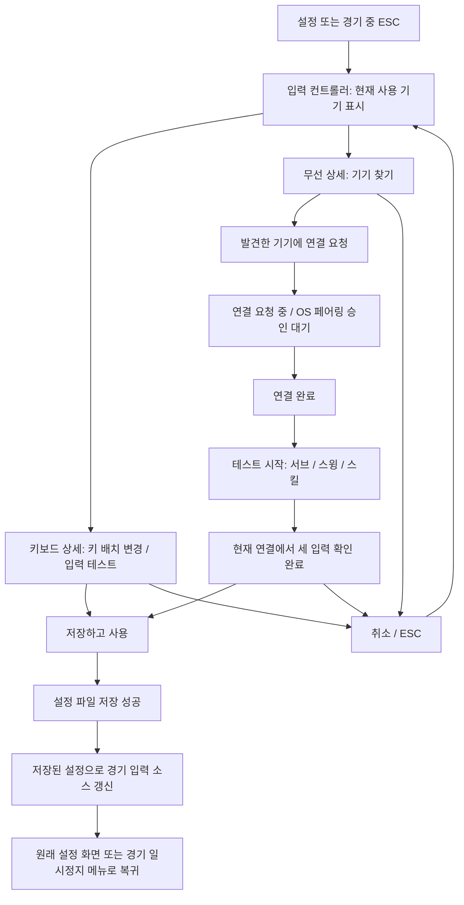
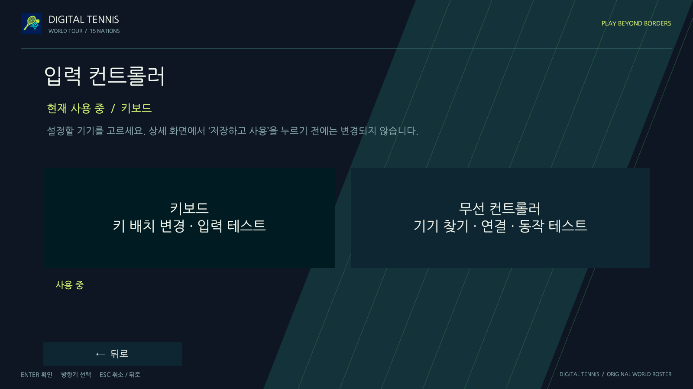
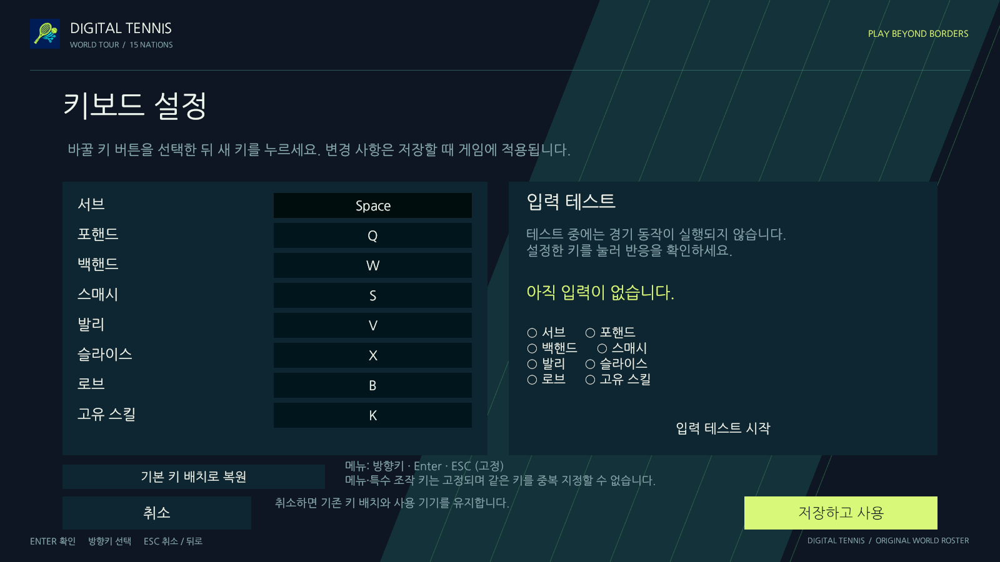
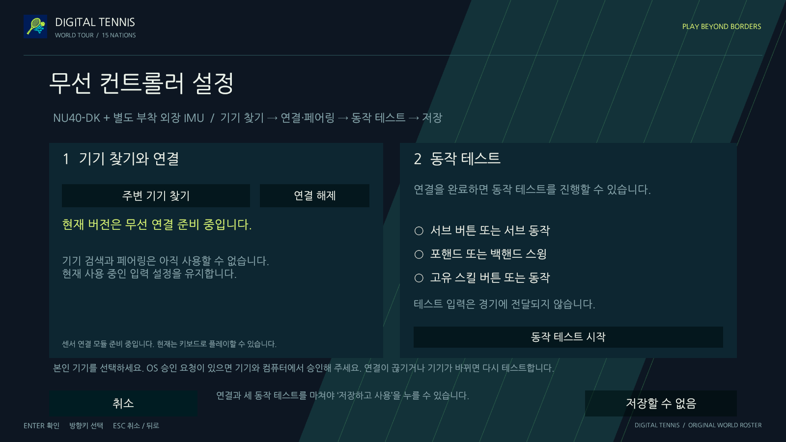
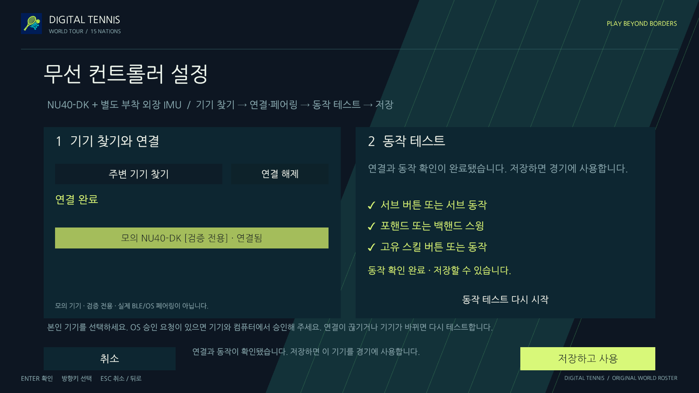

# 기기별 입력 설정: 상세 편집 → 테스트 → 저장

> v3 물리 이벤트와게임해석의 현재구조는 [물리컨트롤러입력](physical-controller-input.md)을 우선합니다. 구형v1/v2입력과키보드동작은유지합니다.

키보드에는 무선 연결 화면이 필요하지 않다. 입력 기기를 고르는 화면과 해당 기기를 설정하는 화면을 분리하며, 화면을 열거나 항목을 누르는 행위는 게임의 사용 기기를 바꾸지 않는다. **저장 성공이 실제 경기 설정을 바꾸는 유일한 사용자 동작이다.**

## 화면 흐름



### 입력 컨트롤러 목록

‘키보드’, ‘무선 컨트롤러’라는 두 메뉴와 현재 사용 중인 기기를 표시한다. 이 화면에는 검색·연결·해제 패널을 놓지 않는다. 각 메뉴를 누르면 그 기기의 상세 편집을 시작한다. 저장하지 않으면 현재 설정을 유지한다는 안내를 보여 준다.

### 키보드 상세

- 서브·포핸드·백핸드·스매시·발리·슬라이스·로브·스킬의 여덟 키를 표시한다.
- 바꿀 키 버튼을 고르면 다음 키를 받아 임시 배치에 반영한다. 중복 키와 메뉴/특수 조작에 예약된 키는 설명과 함께 거부한다. 키를 고르는 중 ESC는 키 지정만 취소하고, 이후 ESC는 상세 편집을 취소한다.
- 기본 키 배치 복원과 입력 테스트를 제공한다. 테스트에서 감지한 동작을 화면에 표시하며 공·점수·네트워크 입력은 만들지 않는다. 키보드 테스트는 확인 도구이며 저장의 필수 조건은 아니다.
- 키 배치 변경, 기본값 복원, 테스트는 저장 전까지 실제 게임에 영향을 주지 않는다. ‘저장하고 사용’은 키 배치와 사용 기기를 함께 저장하고 원래 화면으로 돌아간다. ‘취소’는 임시 변경을 버리고 기기 목록으로 돌아간다.
- 검색·페어링·연결 해제·무선 하드웨어 문구를 이 화면에 표시하지 않는다.

### 무선 컨트롤러 상세

1. **기기 찾기:** 전원을 켜고 검색한다. 검색 중에는 중복 요청을 막고 취소할 수 있다. 발견 목록을 페이지로 보여 준다. 발견하지 못하면 전원/거리 확인 후 다시 시도할 수 있다.
2. **연결 요청:** 목록의 본인 기기를 선택한다. 요청 중과 OS 페어링 승인 대기를 구별한다. OS 승인 절차 자체는 플랫폼 모듈이 담당하며 UI가 승인된 것으로 꾸미지 않는다.
3. **연결 완료:** 연결 완료를 표시하되 아직 저장을 허용하지 않는다. ‘동작 테스트 시작’을 눌러 이전 대기 입력을 버리고 새 테스트를 시작한다.
4. **동작 확인:** 서브, 포핸드 또는 백핸드 스윙, 스킬의 세 입력을 현재 연결에서 확인한다. 입력의 시간·시퀀스·범위·연결 epoch 검사를 통과해야 한다. 테스트 입력은 경기에 전달하지 않는다.
5. **저장하고 사용:** 현재 연결의 세 동작이 모두 확인돼야 활성화된다. 기기 ID와 사용 기기, 기존 키보드 배치를 파일에 저장한 뒤 경기 입력을 바꾸고 원래 화면으로 돌아간다.

연결 끊김, 재연결, 연결 기기 변경은 테스트 결과를 무효화한다. 테스트 완료 표시를 파일에 저장하거나 새 연결에 재사용하지 않는다. 검색은 20초, 연결/페어링 요청은 60초까지 기다린 뒤 취소·재시도를 안내한다. 취소하면 이 편집에서 시작한 검색/새 연결을 정리하고 저장된 사용 기기는 유지한다. 편집 전부터 사용 중이던 정상 연결은 단순한 취소로 끊지 않는다. 사용자가 명시적으로 연결 해제/다른 기기 연결을 요청하면 실제 물리 연결 상태는 바뀔 수 있지만, 저장된 설정까지 자동 변경되지는 않는다.

**현재 실물 BLE 모듈은 후속 작업이다.** 정상 무선 상세에는 준비 중과 실제 기능 부재를 안내하고 검색·테스트·저장을 비활성화한다. 키보드를 쓰는 사용자가 무선 메뉴를 둘러봤다는 이유로 미연결 센서 사용 상태가 되지 않는다. 연결 완료/테스트 성공을 확인하는 자동 검증에서는 화면에도 명시한 모의 서비스를 주입한다. 실물 NU40-DK에 외장 IMU를 별도로 부착하는 전제와 12일/3인 계획은 유지한다.

## 저장과 경기 입력의 책임

| 구성 요소 | 책임 |
| --- | --- |
| `InputDeviceConfiguration` / `KeyboardBindingSet` | 저장된 사용 기기·키 배치·무선 기기 ID를 불변 값으로 보관 |
| `ControllerSetupSession` | 상세 편집의 임시 값, 키 지정, 연결 작업, 입력 테스트, 취소 수명 관리 |
| `IInputDevicePreference` | 설정 파일 읽기와 원자적 쓰기 |
| `InputDeviceManager` / `IInputDeviceSettings` | 저장 성공 후에만 실제 설정·소스를 갱신; UI에서 경기 코드/플랫폼 SDK를 참조하지 않음 |
| `IControllerBackend` | 실제 검색·연결·OS 페어링, 취소, PC 수신 시각·epoch를 붙인 디코딩 이벤트 |
| `IPlayerInputSource` → `PlayerInputRouter` → `PlayerInputAdapter` | 저장된 기기의 입력만 기존 게임/온라인 타격 검사에 전달 |

저장 버튼은 먼저 파일 쓰기를 완료한다. 실패하면 기존 경기 설정을 유지하고 임시 편집 화면에서 오류와 재시도를 표시한다. 저장이 성공하면 양쪽 대기열을 비우고 새 입력 네임스페이스를 사용해 확인 키나 테스트 스윙이 경기로 넘어가지 않게 한다. 키 배치를 바꾸면 경기 HUD의 서브·타격·스킬 안내와 조작 안내도 저장된 값을 표시한다.

`input-controller.json`의 버전 2 예시:

```json
{
  "version": 2,
  "selected": "Sensor",
  "keyboard": ["Space", "Q", "W", "S", "V", "X", "B", "K"],
  "wirelessDeviceId": "platform-specific-device-id"
}
```

내부 `Sensor` 값은 이전 저장 형식 호환용이며 화면에는 ‘무선 컨트롤러’라고 표시한다. OS 페어링 토큰·자격 증명·테스트 통과 상태는 저장하지 않는다. 버전 1은 기본 키 배치로 읽고 이전 선택을 보존한다. 기기 ID가 없는 이전 센서 설정은 연결 준비 완료로 처리하지 않는다. 잘못된 파일은 기본 키보드 설정으로 읽는다.

메뉴의 방향키·Enter·ESC는 별도 복구 경로로 유지한다. 무선 연결 끊김 때 키보드 경기 입력으로 자동 전환하지 않는다. 저장된 기기 ID와 실제 연결 ID가 다르면 경기 입력을 받지 않는다. 모든 경기 입력은 기존 호스트 권위·시각/중복·거리/높이/차례/스킬 검사를 거친다.

`ClearInput`은 모션 입력과 늦게 도착한 모션 전달만 비운다. 발견/연결 상태 작업까지 매 프레임 취소하는 API가 아니다. `Disconnect`는 검색/연결 작업과 그 늦은 콜백도 취소한다. 플랫폼 구현이 이 계약을 지켜야 한다.

## 완료 기준과 검증

- 기기 목록, 키보드 상세, 무선 상세가 구별되고 키보드에는 연결 기능이 없다.
- 상세 화면 열기/편집/테스트/취소는 저장된 설정을 바꾸지 않는다.
- 키 지정 중 ESC와 상세 취소가 구별된다. 테스트의 Space나 스윙이 메뉴 확인/서브로 해석되지 않는다.
- 저장 실패는 기존 소스를 유지한다. 저장 성공은 사용 기기와 키 배치를 함께 적용하고 원래 메뉴로 복귀한다.
- 무선은 발견 → 요청 → 페어링 → 연결 완료 → 세 동작 확인 → 저장 순서를 검증한다. 연결만 됐거나 테스트 일부만 끝난 상태에서는 저장할 수 없다.
- 끊김·다른 기기·새 epoch·중복·오래된/미래 입력·NaN이 테스트 성공이나 경기 입력을 위조하지 못한다.
- 저장 후 실제 경기에서 변경 전 키는 서브하지 못하고 변경한 키가 서브한다. 저장된 무선 입력도 정상 타격 경로를 거친다.
- 새 기능의 실제 Unity 화면과 일반 창 키보드 조작을 확인하고 실물 BLE 검증과 구분한다.

재현:

```sh
bash tools/unity.sh check
bash tools/unity.sh test-edit
bash tools/unity.sh test-play
bash tools/unity.sh build-verification-mac
python3 tools/verify-controller-ui.py --out .work/controller-setup-ui
```

일반 창 검증 전용 번들은 `ControllerValidation/input-controller.json`에 저장해 사용자 게임의 기존 파일과 분리한다.

모의 서비스는 개발 빌드의 명시적 `-dt-controller-ui-verify`에서만 설치한다. 검증은 정상 UI 명령과 실제 입력 어댑터를 사용하며 공·점수·캐릭터 위치를 직접 쓰지 않는다. GPU 보고서와 24개 화면, 바이너리/소스/이미지 해시는 `.work/controller-setup-ui`에 생성한다. 실제 결과와 화면은 아래에 기록한다.

## 확인 결과

- Unity 프로젝트 검사 / Mac 검토 빌드 통과. 최종 기능 검사는 **EditMode 185/185 · PlayMode 42/42**, 실패·건너뜀 0. 마지막 메뉴 안내 문구 정리는 프로젝트 검사·새 Mac 빌드·GPU 전 흐름으로 다시 확인했다.
- 저장 실패, 취소, 예약/중복 키 거부, v1→v2 읽기, 파일 저장, 테스트 이벤트의 시각/중복/epoch 검증, 연결 끊김/다른 기기와 재테스트, 일반 온라인 입력 경로 유지, 테스트의 경기/온라인 입력 차단을 포함한다.
- 실제 GPU 1600×900 화면 **24장**, 실행 오류 0. 모의 검색→요청→페어링→연결→부분 테스트→완료→저장 및 저장 후 실제 센서 타격 경로, T 키 서브를 확인했다.
- **일반 Mac 창의 실제 OS 키 입력**으로 키보드 상세의 T 지정→취소→Space 유지, 키 테스트, 저장 후 메뉴 복귀, T 설정 파일 생성, 경기에서 Space 무반응/T 서브와 HUD 변경, 무선 상세의 저장 차단, 기본값 복원/저장을 확인했다. 해당 창에는 모의 연결 서비스나 주입 입력 소스를 설치하지 않았다.
- 정상 게임의 기존 사용자 설정은 v1 Keyboard 상태로 유지했다. 일반 창 검토는 별도 ControllerValidation 파일을 사용했다. 실물 BLE/페어링, Windows 실기·WAN·두 클라이언트 전체 경기 재검사는 이번 완료로 세지 않는다.

[검증 집계](reports/controller-setup-flow/validation.json)

기기 목록 — 두 종류의 상세 설정을 여는 메뉴이며 선택 즉시 적용하지 않는다.



키보드 상세 — 연결 UI 없이 키 배치와 입력 테스트, 취소/저장을 제공한다.



정상 무선 상세 — 실제 연결 모듈 부재를 안내하고 저장할 수 없음을 명시한다.



개발 전용 모의 검증 — 현재 연결에서 세 동작이 확인된 뒤 저장이 활성화된다. **실물 연결 성공 화면이 아니다.**


