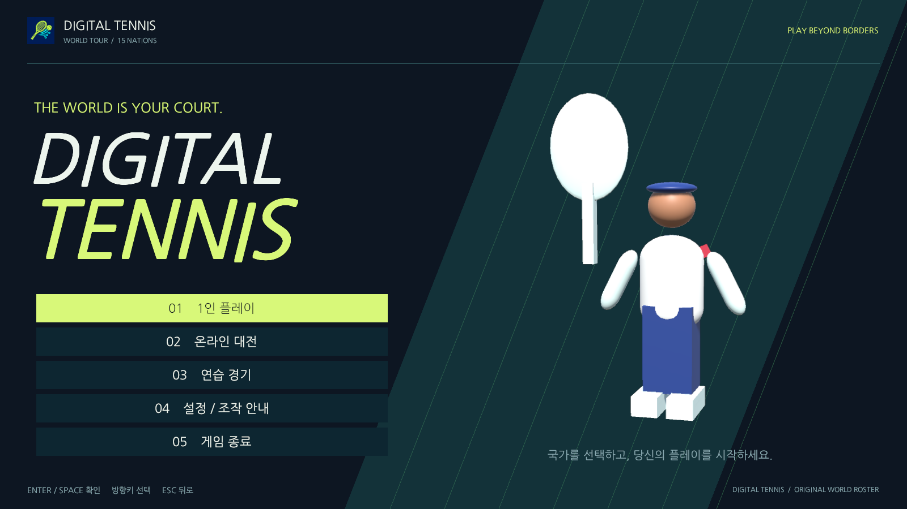
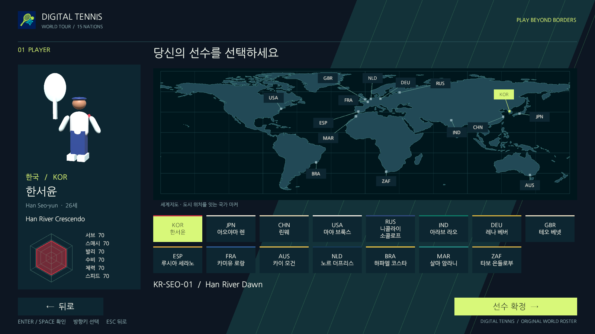
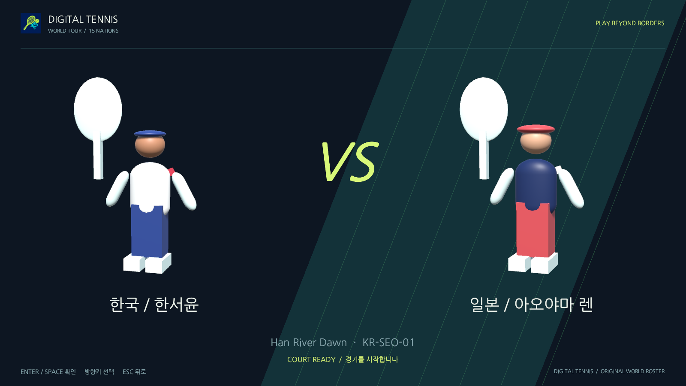
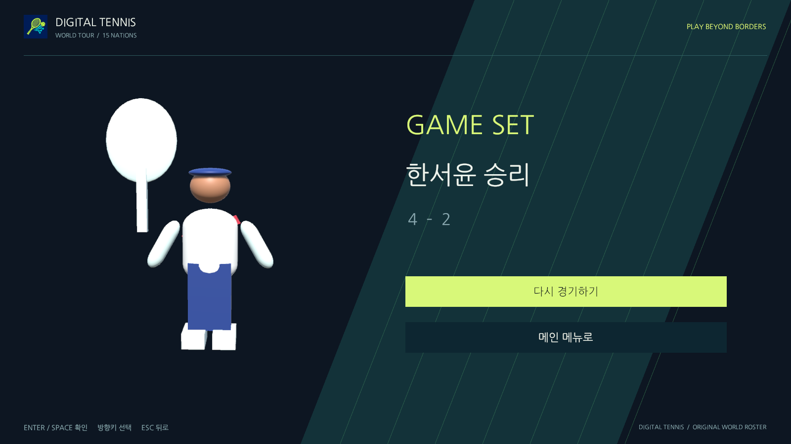

# 시작 화면·세계지도 선택·경기 시나리오

## 플레이 흐름

실행 시작 씬은 `FrontEnd`입니다. `SinglePlayerCourt`는 실제 경기 씬으로 함께 불러오며 `MatchCourt`와 `DevelopmentCourt`는 개발 실험용으로 계속 사용할 수 있습니다. 전체 프로젝트의 12일·3명 계획, NU40-DK에 **외장 IMU를 별도 부착**하는 조건과 기존 테니스 규칙은 유지합니다.

1. **조직 로고**: 기존 Digital Tennis 조직 로고를 표시합니다. 준비가 끝난 뒤 약 1.9초 후 타이틀로 이동하며 Enter/Space로 건너뛸 수 있습니다.
2. **타이틀**: 게임 이름·슬로건·실제 3D 선수 미리보기를 표시합니다. 시작 버튼 또는 Enter로 메뉴에 들어갑니다.
3. **메인 메뉴**: 1인 플레이 / 온라인 대전 / 연습 경기 / 설정·조작 안내 / 종료를 고릅니다. 종료는 게임 안에서 한 번 더 확인합니다.
4. **세계지도 선수 선택**: 지도상의 15개 도시 마커 또는 하단 선수 카드를 선택합니다. 국가·한글 이름·나이·고유 스킬·6개 능력치가 함께 바뀝니다. 복잡한 유럽·동아시아 마커는 실제 도시 점과 연결선으로 분리했습니다. 방향키로도 모든 선수에 접근할 수 있습니다.
5. **상대·난이도 선택**: 1인/연습은 상대 국가도 고릅니다. 1인 AI 난이도는 하·중·상입니다.
6. **코트 선택**: 국가별 코트 이름·코드를 보고 고릅니다. 경기에는 해당 배색·배경 장식이 적용되며 테니스 물리와 라인 판정은 공통입니다.
7. **대진 소개**: 양쪽 선수와 코트를 약 2.2초 소개합니다. 이때 서브가 미리 나가지 않습니다.
8. **경기**: 새 HUD에 점수·판정·선수·스킬 사용권/충전/체력을 표시합니다. Space 서브, Q/W 포핸드/백핸드, S/V/X/B 추가 타격, K 스킬을 사용합니다.
9. **경기 메뉴·결과**: Esc로 경기 메뉴를 열고 계속/조작 안내/메인 메뉴를 고릅니다. 오프라인에서는 공과 경기 시계가 멈춥니다. 경기 종료 후 실제 승자·최종 포인트를 표시하고 재경기 또는 메인 메뉴로 이동합니다. 재경기는 동일 선택을 유지하고 점수·사용권을 초기화합니다.

현재는 기존의 한 게임 단위 경기입니다. 세계지도는 선수·코트 선택이며 국가별 토너먼트/스테이지 해금 기능은 포함하지 않습니다. 선수 모델은 기존 원본 절차적 3D 프로토타입을 사용합니다.

## 온라인에서의 흐름

온라인 대전 → 본인 선수 선택 → 방 생성/6자리 코드 입장 → 양쪽 선수 확인 → 대진 소개 → 온라인 경기로 이어집니다. 호스트는 방을 만들기 전에 코트를 선택할 수 있습니다. 게스트는 자신의 선수 선택 의도를 기존 입력 어댑터로 전달하며 호스트가 확정한 선수·코트를 양쪽 대진 소개에 표시합니다.

온라인 경기 메뉴를 열어도 경기는 계속됩니다. 한 사용자의 로컬 메뉴가 상대의 경기를 멈추지 않도록 했습니다. 연결이 끊기면 기존 재접속 동작을 유지하고, 메인 메뉴로 돌아가면 현재 방에서 나옵니다. 결과 화면의 온라인 재경기는 아직 제공하지 않으며 새 방으로 다시 시작합니다.

경기는 메뉴가 완성될 때까지 `GameplayEnabled`로 타격/서브 입력을 막습니다. 네트워크 연결과 선수 선택 메시지는 계속 처리합니다. 양쪽의 방 입장과 캐릭터 확인이 끝나야 대진 소개를 시작합니다. UI는 점수·게이지·공 궤적을 생성하지 않습니다. 메뉴 방향·확인·뒤로 가기도 KeyboardPlayerInputSource → PlayerInputAdapter.MenuRoute를 사용하므로 향후 보드 입력으로 같은 메뉴 명령을 전달할 수 있습니다.

## 설정과 CSV

설정에서 메뉴 자동 회전과 스킬 카메라 줌을 줄일 수 있습니다. 이 선택은 사용자 저장 설정으로 유지합니다. 조작 안내도 메뉴와 일시정지 화면에서 볼 수 있습니다. 음성/BGM은 별도 조사 단계이므로 작동하지 않는 오디오 슬라이더를 배치하지 않았습니다.

설정 화면에서 외부 밸런스 CSV 경로를 확인합니다. 파일을 수정한 후 서브 대기 중 **F5**를 누릅니다. 활성 스킬이 없어야 하며 잘못된 파일은 이전 값으로 유지합니다. 직접 `SinglePlayerCourt`를 실행하는 개발용 경로에서는 기존 디버그 UI도 사용할 수 있습니다.

## 화면과 구현 책임

| 모듈 | 담당 | 직접 바꾸지 않는 것 |
| --- | --- | --- |
| `FrontEndModel` | 로고·타이틀·메뉴·선택·대진·경기·결과 전환과 확정한 선택 | 테니스 점수·물리 |
| `FrontEndController` | 실제 경기 씬 연결, 선수/코트 확정, 로비·입력 허용·일시정지 | 샷 성공 판정·AI 정책 |
| `FrontEndView` | 한국어 Canvas UI·버튼·능력치·HUD | 경기의 사실 데이터 |
| `FrontEndGraphic` / `WorldRoster` | 지형·능력치 다각형과 실제 도시 위치/표시 연결선 | 국가별 물리 차이 |
| `FrontEndPortraits` | 게임 리그에서 복제한 미리보기 전용 모델과 카메라 | 실제 선수 위치·타격 |
| `FrontEndValidationDriver` | 명시적 실행 인수로만 UI 버튼·정상 입력을 검증 | 점수/공/스킬 강제 조작 |

UI는 1600×900 기준으로 화면 비율을 유지하며 크기를 조절합니다. 새 UI는 게임 카메라에 렌더링되는 Canvas이므로 Mac 잠금 상태에서도 **게임 카메라만** PNG로 저장할 때 메뉴와 점수를 포함할 수 있습니다. 이전 IMGUI 디버그 화면의 캡처 제약과 구분합니다.

## 참고 영상과 실제 적용

- [첫 번째 영상](https://www.youtube.com/shorts/P8e06ACWuso): 요청한 5초 이후를 브라우저에서 직접 재생/탐색했습니다. 약 11초의 타이틀과 약 15초의 세계지도·선수 목록·큰 선수 표시를 확인했습니다.
- [두 번째 영상](https://www.youtube.com/shorts/D_yl_fnD-gM): 지도 위 국가 표시, 하단 인물 목록과 선택한 인물의 확대 표시를 확인했습니다.

이 구성에서 타이틀→선택→대진→경기로 이어지는 순서와 지도/목록/큰 미리보기의 역할을 참고했습니다. Digital Tennis의 조직 로고·색·한국어 UI·15명 고유 선수·테니스 경기 데이터를 사용해 구성했습니다.

## 포함한 자료의 출처

- 로고: 이 프로젝트를 위해 앞서 제작한 Digital Tennis 조직 로고.
- 글꼴: [Google Fonts Nanum Gothic](https://github.com/google/fonts/tree/main/ofl/nanumgothic), SIL Open Font License. 원본과 라이선스를 `Assets/Resources/FrontEnd/Fonts`에 포함했습니다.
- 지도: [Natural Earth 110m 물리 지형](https://github.com/nvkelso/natural-earth-vector/blob/master/geojson/ne_110m_land.geojson), [공개 도메인 사용 조건](https://www.naturalearthdata.com/about/terms-of-use/). 국경선 대신 물리 지형과 캐릭터별 도시 점을 그립니다. 원본을 받으면 `python3 tools/prepare-world-map.py 원본.geojson`으로 UI용 삼각형 데이터를 다시 만들 수 있습니다.
- UI: Editor와 같은 버전으로 제공되는 Unity uGUI 2.0.0. [Unity 6.3 공식 설명](https://docs.unity3d.com/6000.3/Documentation/Manual/com.unity.ugui.html).

## 확인 방법

Unity에서 `Assets/Scenes/FrontEnd.unity`를 열어 Play를 누르거나 새 실행 파일을 시작합니다. 첫 메뉴에서 아무 입력도 하지 않아도 경기가 시작되지 않는지, 지도/목록에서 같은 선수가 선택되는지, 뒤로 갔을 때 확정한 선택이 유지되는지, 대진 소개 후에만 서브가 가능한지 확인합니다.

직접 조작할 때는 일반 게임 앱을 실행하고 게임 창을 활성화한 뒤 **방향키로 선택, Enter/Space로 확정, Esc로 뒤로** 이동합니다. `verify-online.mjs`로 띄운 자동 검증 창은 키보드 소스를 검증 소스로 교체하므로 직접 키보드를 시험하는 창과 구분합니다.

```bash
bash tools/unity.sh setup
bash tools/unity.sh check
bash tools/unity.sh test-edit
bash tools/unity.sh test-play
bash tools/unity.sh build-mac
node tools/verify-front-end.mjs --out /private/tmp/dt-menu-single-proof
node tools/verify-online.mjs --menus --exercise-characters --exercise-officials --exercise-reconnect --exercise-effects --exercise-balance --out .work/windowed-menu-proof
```

전체 시작 흐름의 실행 파일 검증은 `-dt-frontend-verify /절대/출력폴더`로만 활성화합니다. UI 버튼을 통해 15명 선택·설정·대진·실제 1인 경기·일시정지·결과·재경기·메뉴 복귀를 실행합니다. 스윙은 공통 입력 어댑터를 통과하며 검증기가 점수나 공 위치를 바꾸지 않습니다. GPU 화면 검증 시 `-batchmode`를 사용하되 `-nographics`는 사용하지 않습니다. 기존 독립 온라인 검증 및 캐릭터 연출 미리보기의 실행 인수는 실험 경로로 바로 들어갑니다.

그래픽 장치가 없는 PlayMode 검사는 버튼 콜백으로 상태/규칙을 검사하며, 실제 화면 배치와 카메라 이미지는 GPU 실행 파일 검증으로 확인합니다. 미리보기 카메라는 Null 그래픽 장치에서 만들지 않습니다.

잠금 상태의 GPU 배치 실행은 창의 물리 마우스 좌표를 제공하지 않으므로 검증 소스가 실제 Unity Button 콜백을 호출합니다. 이미지와 상태 전환·입력/득점 흐름을 함께 확인하며, 잠금 해제 상태의 실제 마우스 조작 검증과 구분합니다.

### 일반 창의 온라인 메뉴 자동 클릭

온라인 검증 명령에서 `--menus`를 지정하고 `--offscreen`과 `--headless`를 생략하면 일반 게임 창 두 개를 실행합니다. Mac 잠금을 직접 해제한 상태에서 사용합니다. 검증기는 타이틀의 시작 버튼 → 온라인 대전 → 국가 선택 → 선수 확정 → 방 생성/코드 입장 → 대진 소개 → 경기를 진행합니다. 캐릭터 검증 옵션을 켜면 호스트의 코트 선택도 거칩니다.

이 경로는 Unity `EventSystem`에서 실제 버튼 위치를 레이캐스트한 뒤 포인터 클릭 이벤트를 전달합니다. 운영체제 마우스를 움직이는 검증과는 구분하며, 일반 창에서 직접 `Button.onClick` 콜백으로 우회하면 검증이 실패합니다. `--offscreen` 또는 `--headless`는 기존 콜백 경로로 별도 검사할 때만 사용합니다.

이전 검증기는 국가 선택으로 페이지를 다시 만든 **같은 프레임**에서 확정도 클릭했습니다. 새 버튼이 Canvas에서 그려지기 전에는 uGUI 레이캐스트 대상이 되지 않아 확정 위치의 결과가 0건이었습니다. 매 프레임 국가를 다시 선택하면서 페이지가 계속 교체되어 선수 선택에 머물렀습니다. 이제 국가/코트를 한 번 선택한 뒤 다음 클릭을 0.35초 이후의 다른 프레임에서 수행합니다. 이 간격은 검증 전용이며 실제 사용자 입력이나 경기 밸런스를 바꾸지 않습니다.

검증 결과에는 클릭 순서, 포인터/콜백 실행 횟수, 클릭 실패 이유와 화면 방문 순서를 기록합니다. 국가 선택 → 확정 순서와 양쪽 `Playing` 진입을 검사하고, 일반 창에서는 호스트 8회·게스트 5회의 포인터 클릭과 콜백 0회를 요구합니다(호스트 코트 선택 옵션 사용 시). 로고·타이틀·메뉴·선수 선택·로비·코트·대진·경기 화면의 PNG와 JSON도 저장하며, 선택된 국가와 PNG 형식/크기를 검사합니다. 캡처 대상은 Unity 게임 프레임뿐입니다.

## 실행 결과 · 2026-10-15

- Unity 6000.3.26f1의 EditMode 95개·PlayMode 24개가 모두 통과했습니다. 마지막 연결 대기 입력 수정 후에는 화면 흐름 PlayMode 2개를 다시 통과했습니다. 이 추가 실행은 같은 검사 2개의 재실행입니다.
- 프로젝트 검사와 Mac·Windows 빌드가 통과했습니다. Windows 실행은 실제 Windows PC에서 별도 확인해야 합니다.
- 실제 Mac 실행 파일에서 로고부터 메뉴 복귀까지 14개 화면을 저장했습니다. Unity 버튼 콜백 35회·화면 전환 18회·15명 선택을 거쳤고, 1인 경기는 실제 득점으로 4–2 종료했습니다. 일시정지 중 경기 시계 유지와 재경기 점수/사용권 초기화도 확인했습니다.
- 같은 Mac에서 두 실행 파일을 띄워 온라인 메뉴 → 방 입장 → 양쪽 선수 확인 → 실제 대전을 진행했습니다. 양쪽 최종 결과는 4–1로 일치했고 최대 6타 랠리, 스킬 사용, 공 회수, 재접속(epoch 2)을 확인했습니다. 호스트만 물리를 진행했으며 양쪽 실행/프로토콜 오류는 0건이었습니다.
- 외부 네트워크의 두 PC, 실제 Windows 조작, BLE/외장 IMU 및 잠금 해제 상태의 물리 마우스는 이번 검증 범위에 포함하지 않습니다.

### 일반 창 자동 클릭 수정 후 재검증

- 프로젝트 검사, 화면 흐름 PlayMode 2개, Mac 빌드를 통과했습니다.
- `--offscreen`/`--headless` 없이 실제 Mac 게임 창 두 개에서 로고 → 타이틀 → 메뉴 → 선수 선택 → 로비 → 대진 → 경기 진입을 확인했습니다. 호스트는 스페인 코트 선택도 통과했습니다. 한국/스페인 선수를 각각 선택했고 포인터 클릭은 8회/5회, 직접 콜백과 클릭 실패는 양쪽 모두 0회였습니다.
- 두 프로세스 모두 종료 코드 0, 최종 포인트 4–1, 최대 6타 랠리, 다음 서브 5회, 볼보이 공 회수 3회, 재접속 epoch 2를 기록했습니다. 스킬·파티클·CSV 재적용 검증도 포함했고 실행/프로토콜 오류는 0건이었습니다.
- 일반 창에서 생성한 1280×800 게임 PNG 35장과 JSON을 검사했습니다. 데스크톱이나 다른 앱의 화면은 캡처하지 않았습니다. 이 결과는 같은 Mac의 로컬 서버를 이용한 두 클라이언트 검증입니다.
- 같은 출력 폴더에서 추가 옵션 없는 `--menus` 검증도 다시 통과했습니다. 이전 코트/효과 캡처가 제거된 상태에서 양쪽 포인터 클릭 5회, 콜백/클릭 실패 0회, 최종 포인트 4–0과 6타 랠리를 확인했습니다.

### 기본 키보드 직접 확인 · 2026-10-16

Mac 잠금 해제 후 게임을 새로 실행하고, 자동 입력/메뉴 검증 인수 없이 기본 `KeyboardPlayerInputSource`를 사용했습니다. 화면 제어 도구로 게임 창에 운영체제 키 이벤트를 보내 Enter로 타이틀 → 메뉴 → 선수 선택에 진입했습니다. 오른쪽 방향키로 한국 → 일본, 아래 방향키로 프랑스를 선택하고 Enter로 확정했습니다. 상대 선택과 코트 선택에서도 방향키/Enter로 진행했고, 실제 경기에서 Space 서브 → Rally → 득점을 로그로 확인했습니다. 게임 창의 실행 중 화면도 직접 확인했습니다.

별도로 `KeyboardSourceNavigatesRosterAndConfirmsWithoutClickingButtons` PlayMode 회귀 검사를 추가했습니다. 키 상태를 주입한 **키보드 소스 → 입력 라우터 → 어댑터 → 메뉴** 경로로 15명 순환, 상하좌우, Enter/키패드 Enter 확정, Esc 복귀, 선택 이름 표시, 메뉴 중 서브 차단을 검사합니다. 버튼 직접 실행 횟수는 0회여야 합니다. 이 검사를 포함한 화면 흐름 검사 3개와 프로젝트 검사를 통과했습니다. 키 상태 주입 검사와 위 운영체제 키 이벤트 확인은 별도 결과입니다.

이 재실행에서는 사용자가 보고한 입력 불가가 재현되지 않았습니다. 처음 실패한 원인은 아직 확정하지 못했으며, 이번 결과를 키보드 입력 불가의 원인 수정으로 해석하지 않습니다.

### 경기 중 입력 반응 개선 · 2026-10-16

사용자가 이후 **메뉴는 조작되지만 경기에서 반응이 없는 것 같다**고 범위를 좁혔습니다. 해당 실행 로그에는 백핸드 입력의 `WrongPhase`/`OutOfReach`, 스매시 입력의 `Height`가 기록되어 있었습니다. 키가 어댑터와 타격 판정에 도달했으나 조건이 맞지 않아 헛스윙으로 처리됐고, 기존 화면은 성공한 타격에서만 모션을 보여 주고 이 실패 이유를 표시하지 않았습니다.

이제 경기 HUD에 실제 마지막 입력과 결과를 표시하고, 공이 타격 가능한 범위에 오면 **지금 Q/W로 타격**을 알립니다. 서브 대기·볼보이 공 회수·연결 복구·스킬 연출도 구분합니다. **이동은 자동**이며 Q/W는 포핸드/백핸드, S는 높은 공에 쓰는 스매시입니다. 오프라인/호스트는 실제 판정 결과를 표시하고, 온라인 게스트는 입력 전송 여부와 수신한 타격 가능 상태를 표시합니다. 전송 표시가 타격 성공을 의미하지는 않습니다.

새롭고 유효한 헛스윙에도 라켓 모션을 재생합니다. 이미 모션 중인 헛스윙은 모션을 계속 처음으로 돌리지 않습니다. 중복·오래된 입력은 모션을 재생하지 않으며, 공의 위치/속도·점수·사용권/체력은 기존 성공 판정에서만 변합니다. 타격 거리/높이, 이동 속도와 다른 CSV 밸런스 값은 이번 변경에서 조정하지 않았습니다.

기본 키보드의 실제 입력을 기록하려면 일반 창으로 실행하면서 `-dt-input-observe /절대/출력폴더`를 지정합니다. 명시적으로 켠 이 관찰 모드는 입력 소스를 교체하거나 키를 만들지 않고, 메뉴 전환/실제 경기 입력 후 게임 PNG와 JSON을 최대 48회 저장합니다. 기록에는 `inputSource`, 실제 동작, 타격 결과, 표시된 안내, 타격 수와 스윙 상태가 포함됩니다. 경기를 자동으로 종료하지 않습니다. 자동 플레이 검증 인수와 구분하며, 운영체제나 다른 앱은 캡처하지 않습니다.

검증 결과:

- EditMode 110개·PlayMode 29개, 프로젝트 검사, Mac 빌드를 통과했습니다. PlayMode에는 화면 흐름 검사 4개가 포함됩니다.
- 일반 창의 기본 Keyboard 소스에 운영체제 키 이벤트를 보내 Space 서브, Q 포핸드 성공 1회, W 백핸드 성공 1회, 백핸드 헛스윙 모션과 안내를 확인했습니다. 실제 키 입력 관찰 PNG 33장을 저장했습니다. 빠른 연속 입력은 하나의 화면 기록에 묶일 수 있어, 성공 타격은 `TENNIS_SWING` 게임 로그도 함께 확인했습니다.
- 별도 두 프로세스의 GPU 카메라 온라인 검사(`--menus --offscreen --exercise-characters --exercise-officials --exercise-reconnect --exercise-effects --exercise-balance`)에서 양쪽 4–1, 6타 랠리, 스킬 3개 충전 후 각 1회 발동, 재접속 epoch 2, CSV 재적용과 파티클을 확인했습니다. 양쪽 실행/프로토콜 오류는 0건이며 게임 PNG 35장을 저장했습니다. 이 검사는 검증 입력 소스를 사용하며 위 기본 키보드 검사와 구분합니다.
- 첫 온라인 실행은 정상 종료/점수는 일치했지만 한 랠리의 입력 기회를 놓쳐 스킬 3개 충전 검사에 실패했습니다. 검증 소스에만 있던 추가 높이 0.95 m 제한을 제거하고 기존 실제 타격 가능 판정을 사용한 뒤 전체 검사를 다시 통과했습니다. 실제 게임의 높이 조건이나 스킬 검사 기준은 낮추지 않았습니다.

아래 이미지는 디자인 시안이 아니라 실행 중인 게임 카메라와 UI를 함께 저장한 화면입니다.








