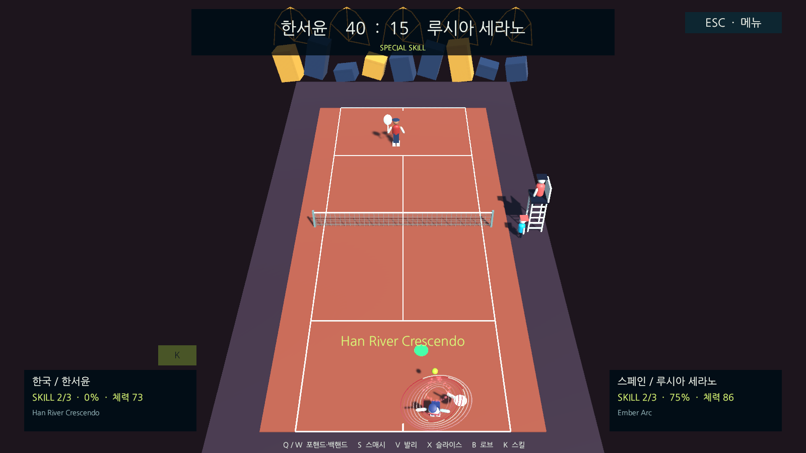
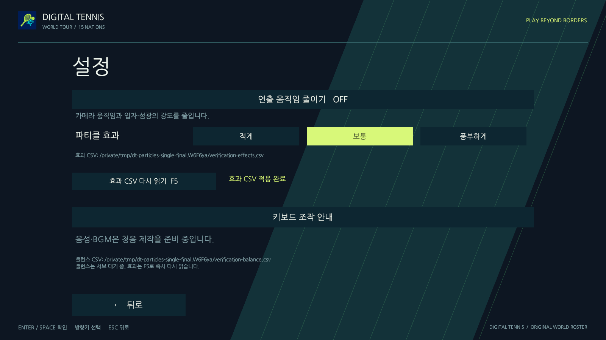
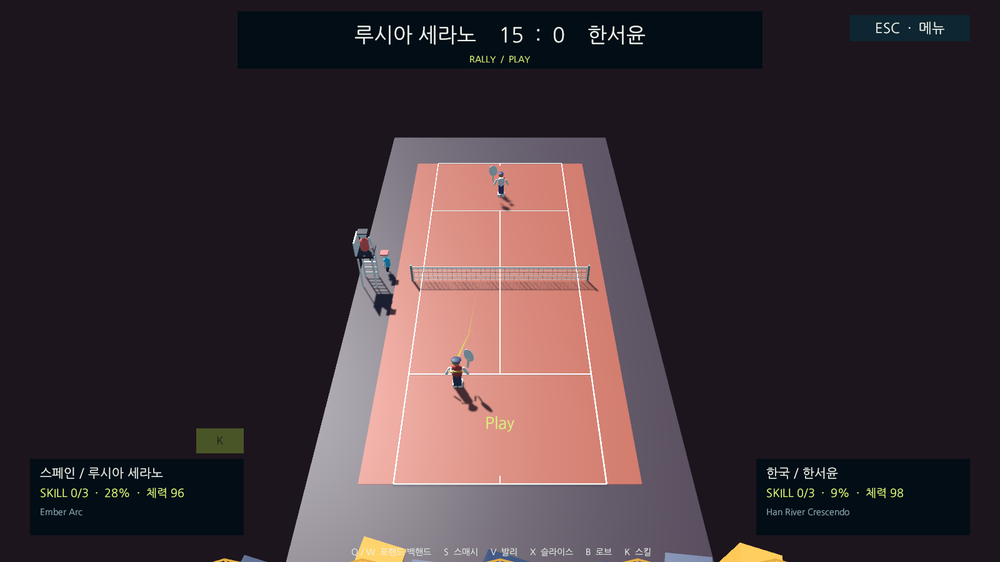
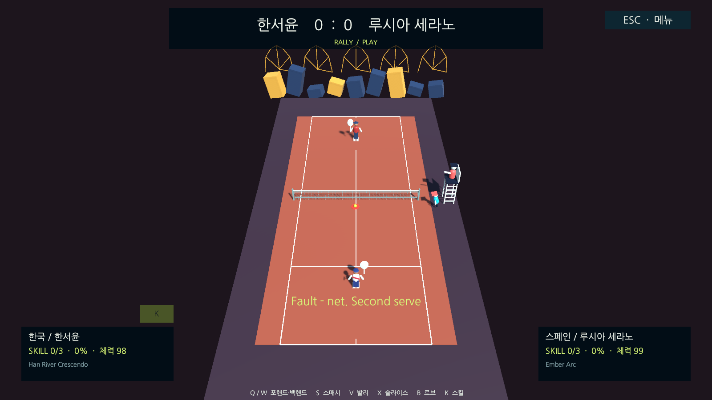

# 경기 파티클 효과

## 적용 범위

1차 범위는 서브·성공한 타격·유효하게 처리된 바운스·스킬 사용권 획득·고유 스킬 발동입니다. 모든 효과는 기존 테니스 판정의 결과를 표시합니다. 파티클 충돌로 공을 움직이거나 점수를 바꾸지 않으며, 기존 1.2초 스킬 연출 시간을 연장하지 않습니다. 별도 네트 파동·발밑 먼지·승리 색종이는 후속 범위입니다.

| 사건 | 표시 | 발생 조건 |
| --- | --- | --- |
| 서브 | 밝은 접촉 링·짧은 입자 분출·공 잔상 강조 | 실제 서브가 허용되고 공이 발사됨 |
| 포핸드·백핸드 등 | 공 접촉 위치의 링과 타격 방향을 따라 흩어지는 입자 | 공통 입력 게이트를 통과한 성공한 리턴 |
| 스매시 | 타격 효과와 더 굵어진 짧은 공 잔상 | 일반 타격과 같은 규칙을 통과한 스매시 |
| 바운스 | 지면의 작은 링과 코트 재질에 맞는 입자 | 경기 규칙이 수락한 실제 바운스 사건 |
| 사용권 획득 | 선수 위 상승 입자·링, HUD 사용권 숫자의 짧은 강조 | 실제 사용권 수가 증가함. 최대 3개에서 반복하지 않음 |
| 스킬 | 입자 집중 → 0.42초의 분출 → 소멸, 캐릭터별 물결/꽃잎 형태의 링 | 사용권을 소비한 실제 스킬 발동 |

바운스 색을 인/아웃 판정의 대체 수단으로 사용하지 않습니다. 폴트·아웃·렛 등은 기존 심판 콜이 알려줍니다. 일반 공·라인·스코어를 계속 읽을 수 있도록 효과의 크기와 수명을 제한했습니다. 캐릭터 스킬은 기존 페르소나의 강조 색과 개별 스타일로 모양·회전 리듬을 바꿉니다.

## 설정과 빌드 없는 조정

기본 메뉴의 설정에서 **적게 / 보통 / 풍부하게**를 고릅니다. 선택은 해당 PC에 저장하며 상대 PC의 설정을 바꾸지 않습니다. **연출 움직임 줄이기**는 기존 카메라 움직임과 함께 입자 수·크기·밝기도 줄입니다.

최초 실행 시 `Assets/StreamingAssets/Effects/effects.csv`를 사용자 저장 폴더의 `Effects/effects.csv`로 복사합니다. 실제 경로는 설정 화면에 표시합니다. 외부 파일을 수정하고 설정의 **효과 CSV 다시 읽기** 또는 **F5**를 누르면 다음 효과부터 적용합니다. 경기 중 F5는 효과를 즉시 읽고, 기존 밸런스 CSV는 기존 조건대로 서브 대기 중에만 읽습니다. 온라인 게스트의 효과 CSV는 로컬 표시 설정이며 서버로 전송하지 않습니다.

```csv
effect,enabled,count,duration,size,speed,color
serve,1,22,0.28,0.52,2.8,#FFF6D6
hit,1,18,0.24,0.42,2.4,#FFF6D6
bounce,1,10,0.45,0.38,0.8,#B9DED1
charge,1,20,0.65,0.62,1.2,character
skill,1,48,1.2,1.3,2.6,character
```

- `enabled`: 0은 해당 효과 끄기, 1은 켜기입니다.
- `count`: 기본 입자 수 0–64입니다. 설정의 밀도 배수가 추가 적용되며 슬롯당 128개를 넘지 않습니다.
- `duration`: 초 단위 수명입니다. 일반 효과 0.06–0.8, 스킬 0.06–1.2입니다. 경기 시계나 능력 강화 시간에는 영향을 주지 않습니다.
- `size`: 링의 기본 반경 0.05–2m, `speed`: 입자 분출 속도 0–5m/s입니다.
- `color`: HTML 색 또는 `character`입니다. 바운스 입자는 코트 표면의 색을 우선하며, 스킬은 기본적으로 캐릭터 강조 색을 사용합니다.

다섯 행은 모두 필요하며 중복·알 수 없는 효과·무한대/NaN·범위 초과·잘못된 색·32KiB 초과 파일은 전체 적용을 거부합니다. 실행 중 오류가 생기면 이전 정상 설정을 보존하고 설정 화면에 알립니다. CSV는 기존 효과의 값을 조절합니다. 새로운 모양·재질·효과 종류를 추가하는 작업에는 코드/에셋 수정과 빌드가 필요합니다.

## 온라인·수명·성능

호스트가 확정한 효과 식별자·종류·실제 접촉 위치·방향·캐릭터·경과 시간을 스냅샷에 추가합니다. 최근 최대 16개·2초 기록만 전달하고 입자 자체의 좌표는 각 PC에서 계산합니다. 게스트는 공/선수와 같은 지연 표시 시점에 효과를 소비하며, 자신의 물리나 화면 좌표로 접촉 위치를 추측하지 않습니다.

새 경기나 재접속 epoch의 첫 스냅샷은 기준점으로만 사용합니다. 중복·역순 사건은 다시 재생하지 않고 수명이 지난 효과는 생략합니다. 연결이 끊기거나 경기를 나가면 활성 효과와 공 잔상을 지웁니다. 오프라인 일시정지에서는 효과 시계와 수명을 멈추지만, 기존 스킬 연출 중에는 입자 연출을 진행합니다.

Unity 기본 Particle System과 LineRenderer, Editor API로 만든 부드러운 입자 텍스처/재질을 사용합니다. 생성한 12개 슬롯을 재사용하고 한 슬롯은 최대 128개 입자만 표시하므로 동시에 최대 1,536개입니다. 실시간 입자 조명·그림자·물리 충돌은 사용하지 않습니다. 이는 수량 제한이며 실제 Windows GPU 성능을 측정한 FPS 보장은 아닙니다.

## 모듈과 확인 방법

- `TennisEffectData`: CSV 검증/원자적 재적용, 고정 크기 사건 기록, 중복·재접속 기준점 처리.
- `TennisEffects`: 경기 사건과 캐릭터 자료를 받아 로컬 파티클 풀·링·HUD 강조·잔상을 표시.
- `TennisEffectsSetup`: Unity Editor API로 재질·텍스처와 경기 씬 연결을 생성. 기존 씬/GUID는 보존.
- `OnlineProtocol`의 선택적 효과 기록: 서버 중계 계약은 그대로 사용하며 수신 게임이 배열·숫자·좌표·식별자를 검증.

```bash
bash tools/unity.sh setup
bash tools/unity.sh check
bash tools/unity.sh test-edit
bash tools/unity.sh test-play
bash tools/unity.sh build-mac
node tools/verify-online.mjs --menus --offscreen --exercise-characters --exercise-officials --exercise-reconnect --exercise-effects --out /private/tmp/dt-effects-proof
```

`--exercise-effects`는 검증 전용 외부 CSV를 만들고 실제 키보드 어댑터의 F5 동작으로 타격 입자 수를 18→26으로 바꿉니다. 실제 리턴으로 사용권을 충전하고 스킬을 사용한 뒤 양쪽의 효과 종류·입자 수·중복·재접속 기준점을 검사합니다. `-dt-effects`의 검증용 풍부한 밀도는 사용자의 저장 설정을 변경하지 않습니다. 두 클라이언트 실행은 같은 Mac의 실제 독립 프로세스와 WebSocket 중계이며, WAN/물리 Windows/BLE 검증과 구분합니다.

화면 저장은 Mac 잠금을 유지한 채 실행 중인 게임 카메라와 Canvas만 읽습니다. 검증기가 효과를 위해 점수·공 위치·스킬 사용권을 강제로 만들지 않습니다. 그래픽 장치가 없는 PlayMode 검사는 사건/규칙을 검사하며, 실제 파티클 표시와 화면 배치는 GPU 실행 파일에서 따로 확인합니다.

## 확인 결과 · 2026-10-15

- EditMode **106/106**, PlayMode **26/26** 통과. 연결 경합 수정 후 메뉴 PlayMode 2개를 추가 재실행했고, 프로젝트 검사와 최종 Mac·Windows 빌드를 통과했습니다.
- 실제 1인 실행 파일에서 메뉴·설정·실제 4–2 경기·일시정지·결과·재경기·메뉴 복귀를 확인했습니다. 메뉴의 자동 검증은 Unity 버튼 콜백이며 잠금 해제 화면의 물리 마우스 조작 검증과 구분합니다.
- 실제 독립 게임 프로세스 2개가 최대 6타 랠리, 사용권 최대 3개 충전, 각 선수 스킬 1회, 공 회수와 재접속(epoch 2)을 거쳐 **4–1**로 같은 결과에 도달했습니다. 파티클 중복·통신 프로토콜 오류·실행 오류는 양쪽 모두 0건입니다.
- 호스트 효과 수는 서브 7·타격 24·바운스 35·사용권 충전 6·스킬 2개입니다. 게스트는 재접속 기준점의 과거 서브 1개를 재생하지 않아 73개, 호스트는 74개를 표시했습니다. 게스트 기준점 설정은 2회입니다.
- 각 클라이언트가 12개 슬롯만 생성했고 추가 재생성을 하지 않았습니다. 관측한 동시 입자는 호스트 최대 **158**, 게스트 **156**개였습니다. 이는 이번 경기의 관측값이며 FPS 성능 보장은 아닙니다.
- 실행 중 외부 효과 CSV의 타격 입자 수를 **18→26**으로 바꾸고 양쪽의 로컬 F5 경로로 반영했습니다. 호스트의 게임 밸런스 CSV도 기존대로 70→77/revision 3으로 반영됐습니다.
- 재접속 시 이미 전송 중이던 스냅샷에 대한 `PEER_UNAVAILABLE` 응답을 프로토콜 위반으로 누적하던 경합을 수정했습니다. 방에 참가한 상태의 이 응답만 재접속 대기로 처리하며 다른 오류와 실패한 세션 재개 오류는 계속 오류로 처리합니다. 최종 시험에서는 실제 호스트 소켓에 해당 응답을 넣어 일시정지→epoch 2 재개를 확인했습니다.
- 실제 Windows PC·서로 다른 네트워크·BLE/외장 IMU와 최소 사양 GPU 성능 측정은 별도입니다.








