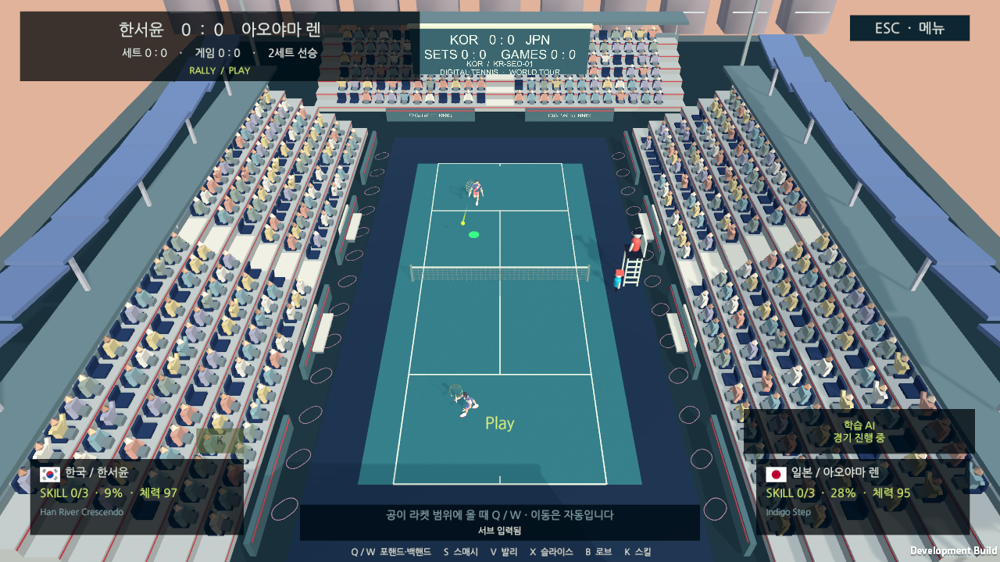

# 학습 AI 연결과 일반 창 검수

2026-10-19. 기존 규칙 기반 AI의 실행 계층에 Stable-Baselines3 PPO로 학습한 코스·깊이 선택 모델을 연결했다. AI 패키지 Git 커밋은 manifest와 Unity 생성 잠금 파일에 고정한다. 학습 도구·모델·관측/행동 계약은 별도 AI 저장소가 소유하고 Unity의 `TennisAiOpponent`는 상태 변환과 일반 입력 적용을 맡는다.

## 수정할 코드와 실행

- AI `Training/train.py`, `Training/actions.csv`, `Training/environment.csv`: 학습 환경/보상/배치 액션. 고정 의존성과 재학습 방법은 [AI 학습 가이드](https://github.com/digital-tennis/digital-tennis-ai/blob/d2e1f004041cd35773fc423c5be65b071d7e9cd8/Training/README.md)를 따른다.
- AI `Runtime/LearnedShotSelector.cs`, `AiPolicy.cs`: 12관측→actor 추론→샷 배치, 물리적인 세기/조준 계산. Unity/게임 어셈블리에 의존하지 않는다.
- game `Assets/Scripts/Runtime/TennisLearnedPolicy.cs`: 번들/로컬 교체 모델 검증·로드. `persistentDataPath/AI/placement-ppo.json`은 다음 경기/AI 재생성 때 적용한다. 모델 교체에 게임 재빌드가 필요하지 않다.
- game `TennisAiOpponent.cs`: 코트 교대 변환, 일반 서브/타격/스킬 입력. pause·online에서는 AI 진행을 금지한다.
- game `FrontEndView.cs`: 학습/대체 AI, 내 서브 대기/상대 서브 준비 상태 표시. 사람 차례에 기다리는 것은 AI 멈춤이 아니다.

```sh
bash tools/unity.sh check
bash tools/unity.sh test-edit
bash tools/unity.sh test-ai
bash tools/unity.sh build-mac
```

1인 플레이→선수/상대/코트 선택→서브 입력으로 시작한다. 기본 키보드 서브는Space, 타격Q/W다. 선택한 무선 입력이 끊겨 일시정지한 경우 입력 설정을 먼저 확인한다. 잘못된 교체 모델은 번들 모델로, 번들까지 없거나 잘못되면 표시된 기본 AI로 대체한다.

## 실제 결과

깨끗한 게임 소스 `bd8037a796ff7f688dbff0ec93bea177e0d08e7e`, AI `d2e1f004041cd35773fc423c5be65b071d7e9cd8`로 Mac 일반 창을 빌드/실행했다. 메뉴는 실제 키보드로 조작하고 키보드 입력을 저장했다. CUA의 실제Space 입력3회 뒤 학습 모델 판단3회와 승인된 AI 반환3회를 확인했다. normal 창 검수에 가상 사람 source·공/점수/재고 주입을 사용하지 않았고, 관찰 옵션은 화면/상태만 저장했다. 추가 NU54 버튼·IMU 검증은 하지 않았다.



[원본 상태](evidence/learned-ai-2026-10-19/ppo-return.json) · [빌드 소스](evidence/learned-ai-2026-10-19/build-info.json) · [검수 결과/해시](evidence/learned-ai-2026-10-19/validation.json) · [민감 정보 없는 이벤트 기록](evidence/learned-ai-2026-10-19/game-events.txt)

| 검사 | 결과 |
| --- | --- |
| 독립 AI 라이브러리 | 28검사,64개 SB3/C# 액션 일치 포함 |
| Unity EditMode | 191통과 |
| Unity AI 장면 | 4통과, 하/중/상2게임 진행·모델 판단·실제 타격·이동·서비스 교대·pause/온라인 격리 |
| 하 장면의 가상 사람/AI 타격 시도 | 9/7, 사람 서브5·AI서브4 |
| 중 장면의 가상 사람/AI 타격 시도 | 35/34, 사람 서브4·AI서브12 |
| 상 장면의 가상 사람/AI 타격 시도 | 14/18, 사람 서브4·AI서브4 |
| 일반 Mac 창 | 실제 키보드 서브, 모델 판단3·AI 반환3, 런타임 예외0 |

장면 자동 검사는 사람 쪽 정규화 입력 fixture를 사용했다. 일반 창의 실제 키보드 결과와 구분한다. 위 타격 수/승패는 고정 fixture의 관찰값이며 AI의 전체 승률 추정치가 아니다. 증거를 추가한 문서 커밋과 실제 빌드 소스 해시를 구분한다.

## 모델 범위

첫 actor는1단계 배치 압박 환경에서 샷의 코스/깊이를 학습했다. 이동·서브·타격 타이밍·스킬 실행은 기존 계층이다. 전체 경기 end-to-end/자기 대전 학습을 완료한 것으로 표시하지 않는다. 분리2,048상황 배치 보상0.568433 대 무작위0.214257도 실제 경기 승률이 아니다. 장기 전술과 모든 동작을 학습하려면 진짜 점수/종료/reset을 제공하는 Unity ML-Agents 또는 Gym bridge 환경을 후속으로 확장한다.

NU40-DK+별도 외장 IMU, 최초12일·3명 계획, 일반 타격 gate, 호스트 물리/점수 권한은 유지한다.

표시 대비만 보완한 최종 소스 `5098f4ad3796`도 다시 clean Mac 빌드해 일반 창에서 키보드 서브·모델 판단1회·AI 반환1회와 패널 가독성을 확인했다. [최종 표시 빌드](evidence/learned-ai-2026-10-19/hud-build-info.json)와 [표시 검수](evidence/learned-ai-2026-10-19/hud-validation.json)는 위 bd8037a의3회 기능 검수와 구분한다. 최종 앱은 키보드 입력 상태로 일시정지했다.

## main 통합 참조

2026-10-19에 AI PR #5를 스쿼시 병합한 main 커밋 `b00d33aa500cc9ae4f94994f8ea0f530f9ec43ba`으로 manifest와 Unity 생성 잠금 파일을 갱신했다. 새 참조 조합에서 Unity 프로젝트 검사·Edit191개를 다시 통과했고 AI main의28검사도 통과했다. 병합된 AI Runtime은 위 실기/장면 검수 소스와 동일하다. 기존 화면/빌드 소스 해시는 당시 검증 기록으로 보존한다.
