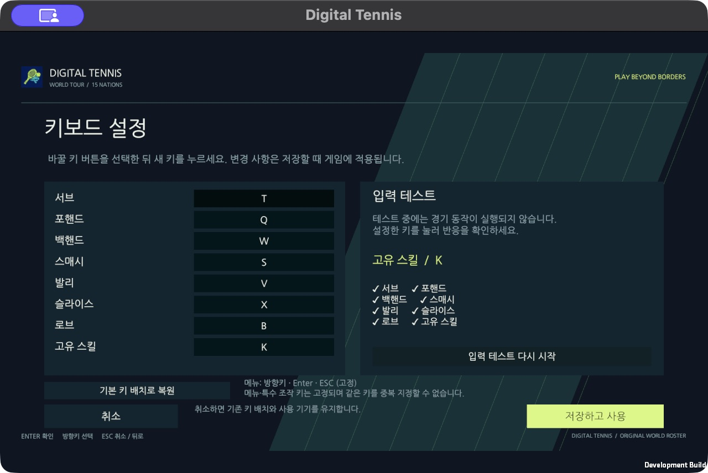
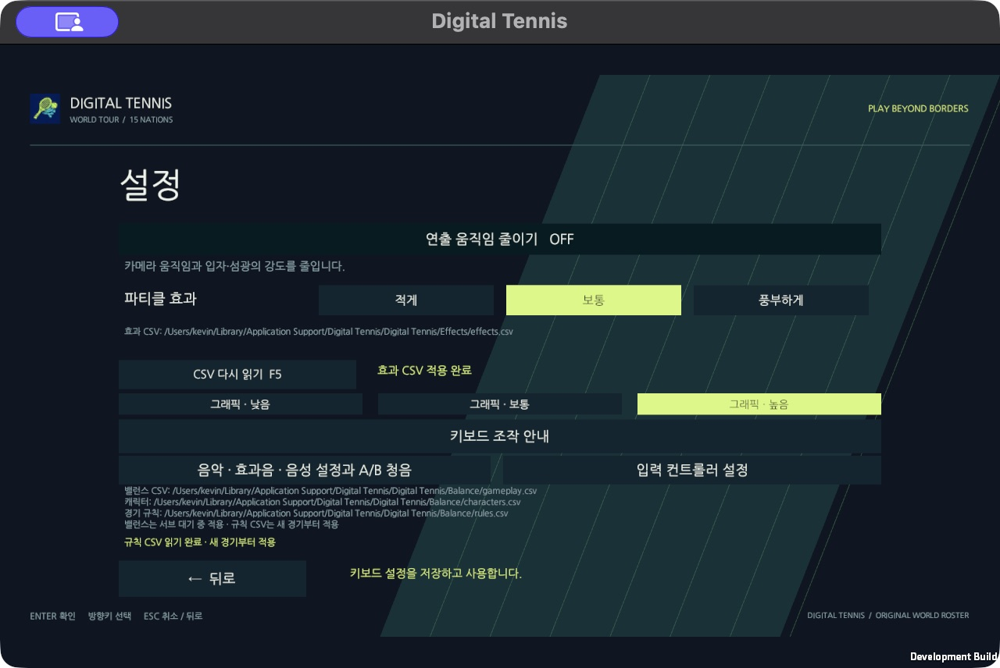

# Mac 일반 창의 마우스 검증

## 검증 경계

키보드로 이동하거나 `Button.onClick`을 직접 호출한 결과를 실제 마우스 클릭의 성공으로 기록하지 않는다. OS 입력, Unity의 포인터 좌표와 포커스, 누름·놓음, UI 판정과 화면 전환을 함께 확인한다. 실제 BLE/외장 IMU 검증과는 별도다.

## GPU 회귀 검사

```sh
bash tools/unity.sh test-mouse
```

이 검사는 실제로 렌더링한 Canvas와 `StandaloneInputModule`의 마우스 처리 경로를 사용한다. 테스트용 BaseInput에서 버튼 누름과 놓음을 서로 다른 프레임에 전달한다. 시작 메뉴, 일본 선수 선택과 확정, 상대 선택, 설정의 키보드/무선 상세, 입력 테스트·취소·저장 후 부모 화면 복귀를 검사한다. 마우스를 누른 상태에서 화면이 전환되거나 한 번의 클릭이 다음 화면까지 연속 확정하면 실패한다. 게임의 `View.Invoke`나 버튼 콜백은 호출하지 않는다.

테스트에서만 입력/포커스를 공급하므로 이 검사의 통과를 실제 OS 클릭의 통과로 바꾸지 않는다. Null graphics의 일반 PlayMode 실행에서는 이 사례를 건너뛰며, 위 GPU 명령으로 반드시 별도 실행한다.

## 일반 Mac 창에서 관찰

```sh
bash tools/unity.sh build-verification-mac
open -n -a "$PWD/Builds/verification/mac/DigitalTennis.app" --args \
  -screen-fullscreen 0 -screen-width 1280 -screen-height 800 \
  -dt-input-observe "$PWD/.work/native-mouse" \
  -logFile "$PWD/.work/native-mouse.log"
```

`-dt-input-observe`는 일반 창에서 수신한 입력만 관찰한다. 게임 버튼을 누르거나 입력 소스를 교체하거나 점수를 바꾸거나 앱을 자동 종료하지 않는다. 관찰 전용 빌드는 별도 앱 식별자와 컨트롤러 설정 경로를 사용한다.

`native-pointer.ndjson`에는 각 MouseDown/MouseUp의 단계·프레임·버튼·포커스, 창 내부 여부, 원시 이벤트 좌표와 폴링 좌표, UI 판정의 첫 대상을 기록한다. 입력 필드의 내용이나 네트워크 토큰은 수집하지 않는다. [Unity Event.mousePosition](https://docs.unity3d.com/6000.3/Documentation/ScriptReference/Event-mousePosition.html)의 좌상단 원점을 UI 판정의 좌하단 원점으로 변환해 비교한다. 선수 선택과 기기 설정의 변화도 관찰 프레임을 남긴다.

실제 클릭 검수 경로:

1. 시작하기 → 1인 플레이 → 일본 선택 → 선수 확정. 한 번의 클릭이 다음 화면까지 확정하지 않는지 확인한다.
2. 뒤로 → 설정 → 입력 컨트롤러 → 키보드 상세. 입력 테스트와 취소·저장 후 복귀를 확인한다.
3. 무선 상세 → 기기 찾기. 장비가 없으면 미연결·테스트/저장 제한을 확인하고 취소한다. 기기 연결 성공으로 기록하지 않는다.

## 자동화 도구의 좌표/권한 문제 구분

여러 모니터와 Retina 배율이 있는 Mac에서 이번 앱 대상 클릭 도구의 이벤트는 창 밖 좌표(예: x=-5074)로 전달됐다. 이 결과는 버튼이 고장났다는 증거가 아니다. 창을 캡처한 픽셀과 macOS의 화면 좌표를 동일하게 취급하지 않는다. 실제 클릭은 게임 창의 위치·크기와 배율을 확인하고 창 안에서 진행한다.

macOS 기본 이벤트 전송 API의 접근 상태가 false라면 OS 승인이 필요하다. 사용자의 텍스트 승인은 OS 인증을 대신하지 않는다. 암호·Touch ID는 사용자가 직접 처리하며, 권한을 우회하거나 다른 앱의 이벤트를 수집하지 않는다.

## 이번 작업의 결과

- GPU 마우스 경로 검사 1개 통과. 실제 버튼 콜백을 직접 호출하지 않았다.
- 기존 메뉴·키보드 PlayMode 검사 6개, Unity 프로젝트·소스 검사를 통과했다.
- 일반 Mac 창에서 도구가 보내는 잘못된 좌표를 원시 이벤트로 재현했다.
- 2026-10-18 일반 Mac 창 검수 완료. Unity 6000.3.26f1, 깨끗한 커밋 `e3a6eca384d9cee156726274f1ecded4eeea0458`의 검증용 Mac 빌드를 실행했다. 콘텐츠는 1280×800, Retina 창 캡처는 제목 표시줄을 포함해 1280×856이었다.
- 사용자가 승인한 임시 앱에서 게임 창의 위치·크기로 화면 좌표를 계산하고, 게임이 앞에 있으며 커서가 콘텐츠 안에 있는지 확인한 뒤 CoreGraphics HID 이벤트로 실제 누름·놓음을 전송했다. PID 직접 전송으로 수신되지 않은 시도는 성공 횟수에서 제외했다. 게임 내부의 버튼 콜백·검증용 자동 진행은 사용하지 않았다.
- 실제 클릭 20회, 원시 이벤트 40개 모두 `focused=true`, `inside=true`이며 의도한 버튼을 판정했다. 버튼 동작의 결함은 재현되지 않아 일반 플레이 입력은 변경하지 않았다.

| 확인 경로 | 실제 결과 |
| --- | --- |
| 시작하기 → 1인 플레이 | 시작 메뉴와 선수 선택 화면 진입 |
| 일본 카드 → 선수 확정 → 뒤로 두 번 | 일본 외형·국기·이름 변경, 상대 선택까지만 확정, 시작 메뉴 복귀 |
| 설정 → 입력 컨트롤러 → 키보드 | 연결 UI 없는 키 설정 상세 진입 |
| 서브 키 Space → T, 입력 테스트 시작 | T/Q/W/S/V/X/B/K 8개 입력 모두 확인, 테스트 중 경기 입력 비활성·득점/타격 0 유지 |
| 취소 → 키보드 다시 열기 | 변경한 T가 저장되지 않고 Space 복원 |
| 무선 상세 → 주변 기기 찾기 | 기기를 찾지 못했다는 상태 표시. 미연결 상태의 저장 버튼을 클릭해도 화면/사용 기기 유지 |
| 무선 취소 → 키보드 → 저장하고 사용 | 설정 화면으로 복귀하고 v2 설정에 Keyboard 및 Space/Q/W/S/V/X/B/K 저장 |

컨트롤러 저장은 검증용 `ControllerValidation` 경로에서 수행했다. 테스트 후 게임을 종료하고, 임시 검증 앱의 손쉬운 사용 권한을 제거했으며 교체했던 다른 작업 폴더의 생성 빌드를 복원했다. 실물 기기 페어링·BLE/외장 IMU 동작은 이번 검수에 포함하지 않았다.

검증 자료: [결과 요약](evidence/mac-mouse-2026-10-18/result.json), [MouseDown/MouseUp 원시 기록](evidence/mac-mouse-2026-10-18/native-pointer.ndjson).





