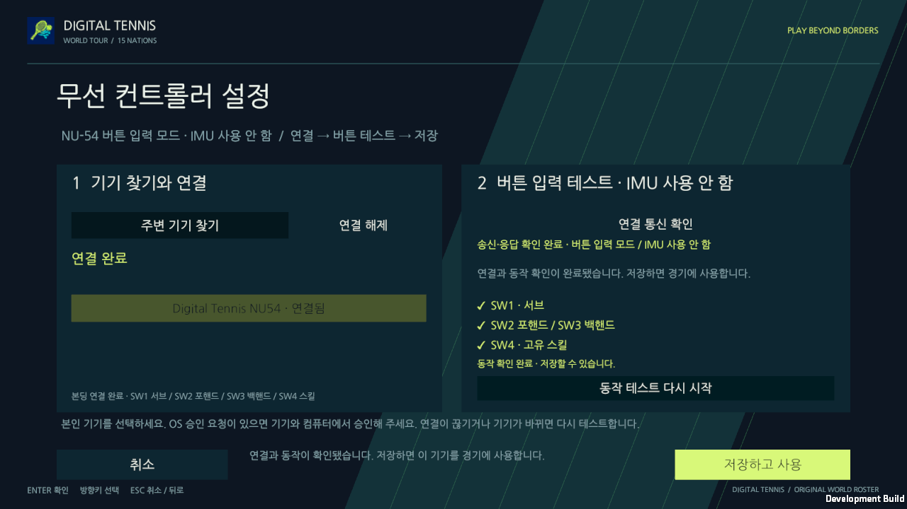
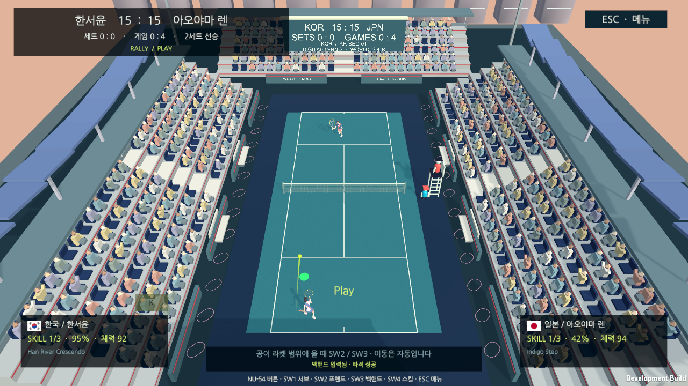
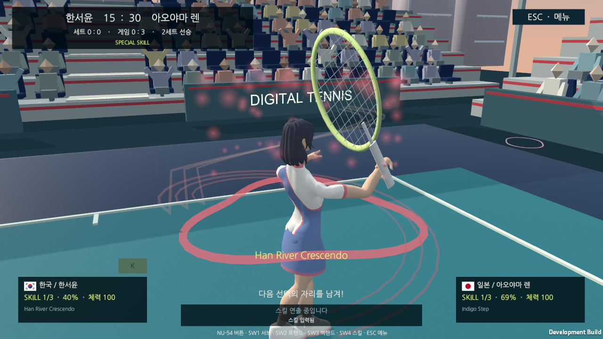

# NU-54 실물 버튼 입력 검수

2026-10-19, Mac 일반 Unity 게임 창. **IMU 검증은 보류**했다. 실제 제품 대상은 NU40-DK+별도 외장 IMU이며 NU-54는 버튼/BLE 시험 기기다.

## 실제 연결과 동작

실제 GPIO 눌림 → 펌웨어의30ms 디바운스 → v2 BUTTON20바이트 → 암호화·본딩 BLE → SDK의현재 프로필/CRC/중복/연결세대 검사 → 정규화 입력 adapter → 기존 테니스 규칙으로 확인했다.

| 실제 버튼 | 프로토콜 | 실제 결과 |
| --- | --- | --- |
| SW1 | BUTTON.kind4 → Serve | 설정 입력 확인, 경기에서 서브·득점·다음 서브 진행 |
| SW2 | BUTTON.kind5 → Forehand | 설정 입력 확인, 실제 포핸드 타격7회 |
| SW3 | BUTTON.kind6 → Backhand | 설정 입력 확인, 실제 백핸드 타격2회 |
| SW4 | BUTTON.kind7 → Skill | 설정 입력 확인, 정상 경기에서 충전 후 실제 스킬2회 |

본딩 재사용 후 현재 nonce의 LINK_REPLY.kind1로 버튼 모드를 확인했다. 실제 네 버튼을 별도로 눌러 설정 테스트를 통과했고, 그때까지 저장은 차단됐다. 테스트 중 타격·득점은0이었다. ‘저장하고 사용’으로 무선 입력을 선택한 뒤 한국 선수와 일본 AI의1인 경기를 진행했다. 키보드는 메뉴 이동에만 사용했다.

IMU ready/calibrated는 거짓이며 센서 보정을 위조하지 않았다. 버튼은 측정 세기·각도를 보내지 않으므로 게임의 CSV 기본 세기와 중립 조준을 사용한다. 타이밍·거리·높이에 맞지 않은 스윙은 기존 규칙대로 거부했다. 실제 서브/수비/타격으로 게이지를 채워 스킬 재고를 얻었고 첫 발동에서 재고2→1, 게이지40% 유지를 확인했다. 검수용 재고 주입·물리/점수 조작·모의 라디오·키보드 경기 입력은 사용하지 않았다. 런타임 예외는0이었다.

## 화면과 원본

[기계 판독 결과·해시](evidence/nu54-buttons-2026-10-19/validation.json), [clean 빌드 출처](evidence/nu54-buttons-2026-10-19/build-info.json), [설치 검증](evidence/nu54-buttons-2026-10-19/firmware-install.json), [식별자 없는 경기 이벤트](evidence/nu54-buttons-2026-10-19/game-events.txt)를 보존했다. 각 PNG 옆 JSON은 같은 정상 게임 프레임의 상태다. 기기 UUID·주소·키·PIN·이전 코드 백업은 포함하지 않았다.

## 소프트웨어 검증과 출처

- C/C# 프로토콜: 공통49벡터와 생성/손상 총2,065사례 일치.
- SDK58검사: 미협상·잘못된 nonce·이전 연결·중복·레거시 메뉴 버튼·위조 스윙 거부.
- firmware: 호스트2모음, NU40/NU54 교차 빌드, USB단일 패킷/128바이트 코드 확인과 오프라인 설치 경계 검사.
- Unity Edit190/190, Play44통과/실패0/NullGPU1제외. 패킷 장면2검사에는 기존 IMU 모드와 새 버튼 모드를 포함한다.

패킷 장면의 라디오는 명시적 소프트웨어 fixture이며 스킬 라우팅을 분리 검사하려고 재고를 준비한다. **위 실물 검수는 그 fixture나 재고 준비 경로를 사용하지 않았다.** 화면 검수는 clean78d609614e57b4680305e64016c9915371d1e7a4의 새 Mac 빌드로 진행했다. 후속 문서/증거 커밋과 실행 소스 커밋을 구분한다. 프로토콜은a1bcb6496c88e14fbfc56d3aa27e96f38dab25c9, SDK는7e960850ad473fe0d990cdde43156423669f9277이다.

NU40 실물 GPIO/별도 외장 IMU, 물리 Windows BLE와 두 물리 PC/WAN 검증은 이번 범위에 포함하지 않는다. 원래12일·3명 계획을 유지한다.
