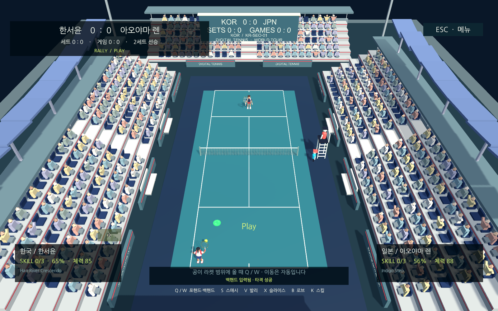
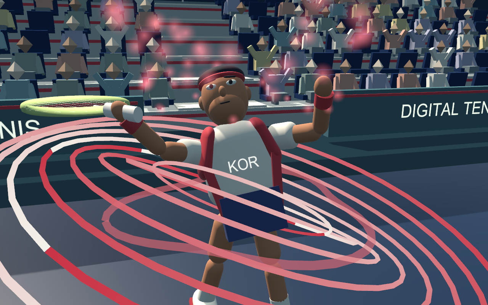
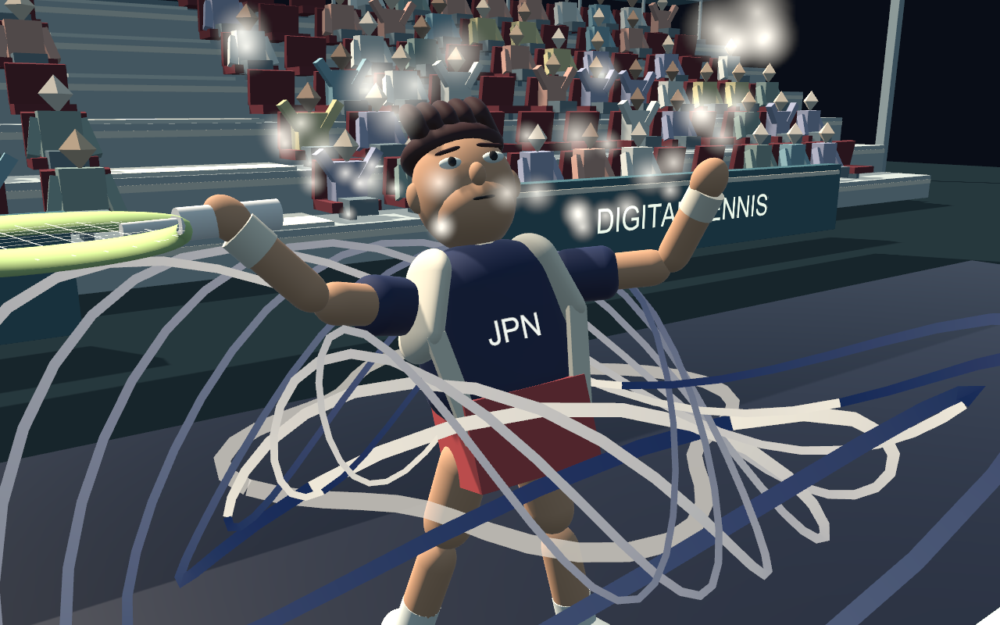
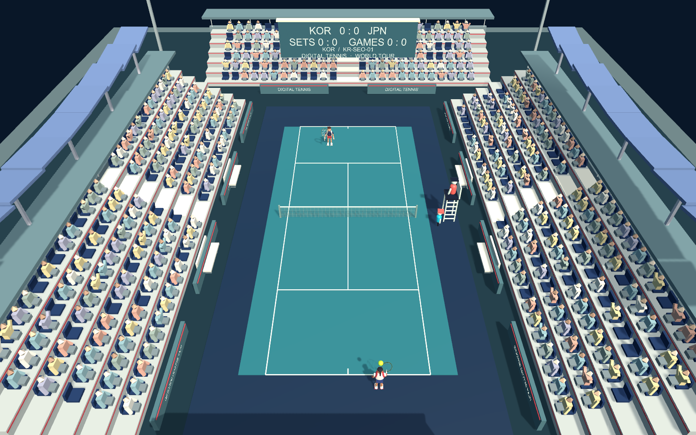
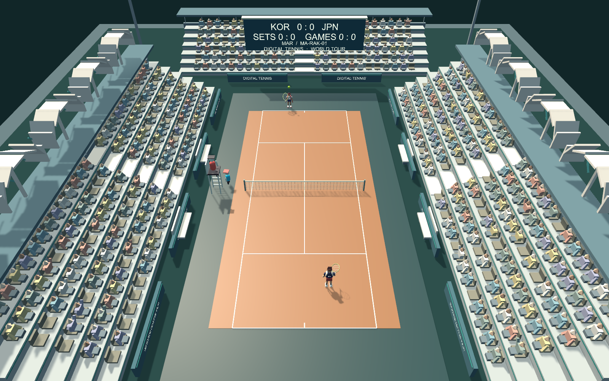

# 게임 완성도 개선 검증

기준 환경: Unity 6000.3.26f1, Built-in/Mono, Mac Apple M2 Max. 소스 구현은 [개선 내용](game-polish.md), 재현 명령은 아래와 같습니다.

## 확인한 결과

- EditMode 138/138, PlayMode 34/34 통과. 실제 랠리에서 손-라켓 그립, 스킬 카메라 중 물리/선수 위치 동결과 복귀, 실제 획득 stock을 제스처 source→adapter로 소비하는 검사를 포함합니다.
- `check`, Mac와 Windows Mono 빌드 통과. Windows는 교차 빌드이며 실제 Windows PC 실행 증거는 아닙니다.
- 서버 `npm run check`, `npm test` 23/23 통과. 서버 초안 [PR #4](https://github.com/digital-tennis/digital-tennis-match-server/pull/4)의 CI도 통과했습니다.
- Mac GPU batch에서 선수 15명·연출 PNG 30장, 경기장 15개·양쪽 시점 30장, 실제 랠리/득점/다음 서브를 확인했습니다. 경기장 624석·관중 502명·추가 경기장 collider 0개입니다. 선수 갤러리는 stock을 부여한 연출 미리보기이며 충전 검증과 구분합니다.
- 오디오 옵션의 실제 버튼/슬라이더, 그래픽 3단계, 음악 A/B 전환, 음원 85개 로드, 잘못된 CSV 거절 후 올바른 재로드를 검증했습니다. 일반 입력과 AI가 3/4회 타격, 1포인트 후 다음 서브가 준비됐습니다. 게임의 실제 AudioListener 혼합 WAV에 잘린 샘플이 없었습니다.
- 온라인 두 프로세스가 메뉴 버튼 콜백으로 선수/코트를 골라 경기했습니다. 87포인트, 세트 2–0, 7–6(TB 8–6) / 6–0으로 종료했습니다. 한쪽만 재경기 요청하면 대기하고 양쪽 요청 뒤 같은 방에서 다른 matchId로 새 랠리와 1포인트를 진행했습니다. 양쪽 모두 Near/Far의 새 헛스윙을 표시했습니다. 소켓 강제 단절 후 epoch2 복구, CSV 호스트 값 동기화, 양쪽의 반대 시점/이동/스윙·효과 중복 방지도 통과했습니다.

최종 단독 음향 재검증은 음원 85개·재생 45회·음악 전환 5회·잘못된 CSV 거절 1회·revision2를 기록했습니다. 환경음 루프의 재시작도 확인했습니다. 단독 1600×900·높음의 807프레임은 중앙값 17.03ms/P95 18.57ms였습니다.



## 캐릭터·AI 조합 기록

15명 × 하/중/상 45개 조합에서 모두 실제 1포인트와 다음 서브 준비를 확인했습니다. 런타임 오류 0개, 합계 타격 210회입니다. seed42·일반 입력의 인접 캐릭터 조합이며 전체 매치업이나 사람 승률을 추정하지 않습니다.









## 재현

프로젝트 Editor를 닫고 다음 순서로 실행합니다. 같은 프로젝트의 Unity batch 명령은 하나씩 실행합니다. 서버 의존성은 형제 저장소에서 `npm ci`로 먼저 준비합니다.

```sh
bash tools/unity.sh check
bash tools/unity.sh test-edit
bash tools/unity.sh test-play
bash tools/unity.sh build-mac
bash tools/unity.sh build-windows
python3 tools/verify-polish.py --out .work/game-polish/recheck
node tools/verify-online.mjs --menus --offscreen --exercise-characters --exercise-officials --exercise-reconnect --exercise-effects --exercise-balance --exercise-rematch --exercise-misses --out .work/game-polish/online-recheck
python3 tools/analyze-balance.py --metrics .work/game-polish/recheck/survey/metrics .work/game-polish/online-recheck/metrics --out .work/game-polish/balance-report
```

검증 전용 입력은 CLI 인자가 있을 때만 설치됩니다. 물리·점수·AI 결과를 쓰지 않고 일반 메뉴/PlayerInputAdapter/SubmitInput을 사용합니다. `verify-polish.py`는 15명×3난이도를 고정 seed42로 한 포인트씩 실행합니다. 이것은 사람의 승률이나 225개 전체 매치업 균형의 증명이 아닙니다.

## 성능과 반복 검증

최종 온라인 재실행은 두 프로세스 모두 최종 score/phase를 일치시켰고, MatchEnd 후 재경기 첫 포인트도 [1,0]으로 일치했습니다. 결과 통지가 최종 30Hz snapshot보다 먼저 올 때 검증기가 직전 점수를 보관하던 경합을 수정했습니다. 실제 결과 UI는 원래부터 검증된 종료 상태를 기다립니다.

| 실행 | 경기 카메라 | Playing 샘플 | 중앙값 | P95 | P99 | Unity 할당 메모리 최대 |
| --- | --- | --- | --- | --- | --- | --- |
| 호스트 | 1600×900 · 높음 | 최초 12,000 | 17.11ms | 18.58ms | 19.49ms | 84.9MB |
| 게스트 | 1600×900 · 높음 | 최초 12,000 | 17.09ms | 18.58ms | 19.54ms | 84.2MB |

게임 PNG 저장 프레임과 직후 3프레임을 제외한 wall frame time입니다. GPU 전용 시간/VRAM/정확한 60fps 보장이 아니며 Mac 잠금 상태의 GPU batch입니다. 두 게임 외에 빌드/검사 작업도 진행됐으므로 전용 성능 벤치마크와 구분합니다. 일반 창·다른 GPU·Windows 성능은 별도 측정합니다.

밸런스 집계는 45개 AI 사례와 온라인 본 경기/재경기를 합한 실제 포인트 133개·타격 시도 244개입니다. 이 중 사람의 승률 자료는 없으며 초기 6개 능력치 합계 420을 유지했습니다. `docs/reports/balance-report.md`와 JSON에서 결과별 횟수를 확인할 수 있습니다.

## 증거와 제한

원시 로그/게임 PNG/WAV/CSV는 Git에 넣지 않고 `.work/game-polish/`에서 생성합니다. 아래 대표 이미지는 실제 게임 카메라 출력입니다. 자동 검증은 사용자의 밸런스/음향 파일을 바꾸지 않도록 독립 CSV를 복사합니다. 음향 검증은 자체 게임 혼합만 녹음하고 스피커 출력을 0으로 하며 마이크/OS 음성은 수집하지 않습니다.

Mac 잠금은 유지했습니다. 일반 창은 잠금 중 프레임이 진행되지 않아 성공 증거로 사용하지 않았습니다. 성공한 실행은 GPU를 사용하는 batch 게임 카메라 렌더링이며 운영체제나 다른 앱의 화면을 캡처하지 않았습니다. 메뉴 검증은 실제 Unity Button 콜백이고 잠금 해제된 창의 물리 키보드/마우스 재검증은 아닙니다.

같은 Mac의 두 프로세스, 로컬 WebSocket 릴레이 결과입니다. 서로 다른 두 PC/WAN, 공용 WSS 운영, 직접 P2P, 실물 IMU/BLE, 전문 배우/각국 언어 음성, 사람의 최종 청음·밸런스 승인은 별도입니다. 미공증 개발 빌드이며 상용 유통/스토어 심사는 수행하지 않았습니다.
