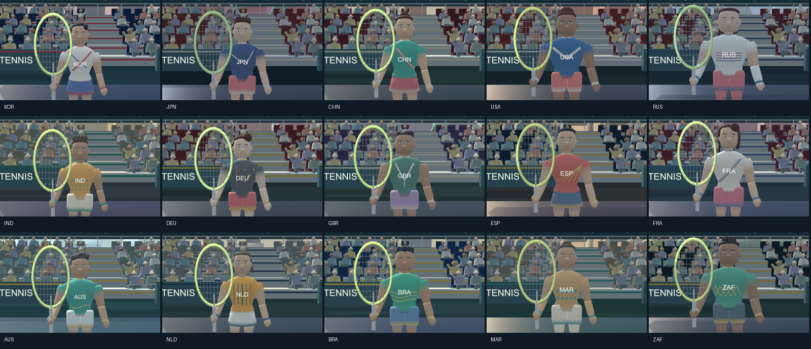
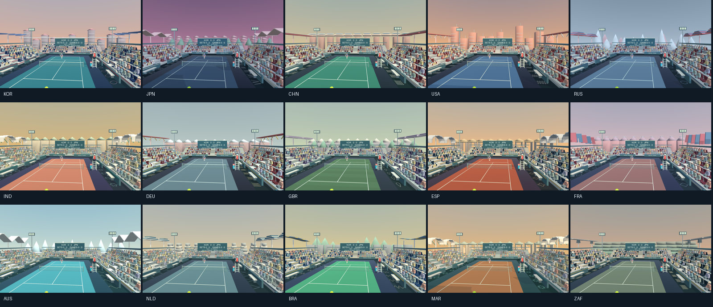
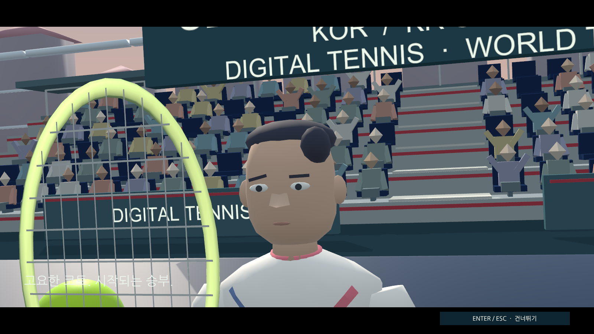
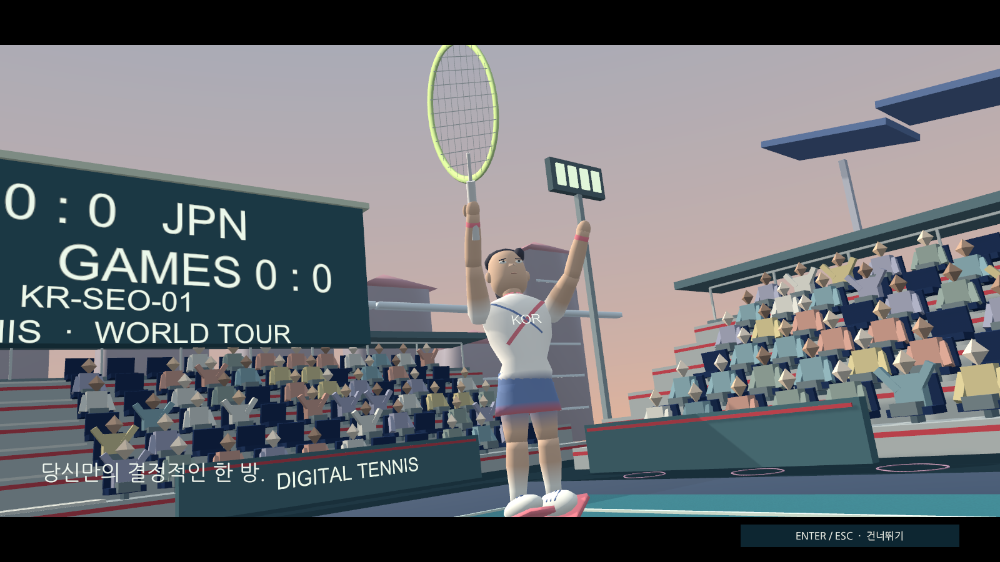

# 게임 완성도 개선 검증

2026-10-16~17, Unity6000.3.26f1·Built-in/Mono·Mac Apple M2 Max. [작업 체크리스트](polish-backlog.md), [구현](game-polish.md), [전체 조합 CSV 전후](reports/matchup-comparison.md)를 함께 읽습니다.

## 현재 확인한 결과

- EditMode158/158, 전체 PlayMode35/35. 오프닝 격리/스킵 검사를 추가한 메뉴 focused5/5를 다시 통과했습니다. 스킨 실제 변형/머리 고정,15본/4표정/법선/가중치,15개 고유 스킬/문양, 접촉 스트링과 손 연결, 접지, 실제 획득 stock의 제스처 소비, 스킬 동결/원래 카메라 복귀를 포함합니다.
- `setup`/`check`와 개발 Mac 빌드 통과. 비개발 Mac/Windows 패키지의 소스clean·Development/AllowDebugging=false와 Mac서명을 확인했습니다. 추가 오프닝 변경을 포함한 패키지도 clean commit에서 갱신합니다.
- 서버 검사24/24와 [PR4 CI](https://github.com/digital-tennis/digital-tennis-match-server/pull/4/checks) 통과. 실제 접촉 좌표의 범위·형식과 릴레이 보존을 포함합니다.
- 새 Mac 게임에서15인 스킨/스킬 준비·강조·복귀·얼굴 총90PNG,15코트의 Near/Far30시점과 전경15시점을 생성했습니다. 연출 갤러리는 명시적으로 stock을 부여한 미리보기이며 충전 증거로 사용하지 않습니다. 가까운 화면에서 보인 얼굴 가림을 리본 수·폭·알파/페이드/뒷면 경로로 줄이고 종료 후 얼굴 캡처를 분리했습니다. 속바지 영역 재질도 보정했습니다.
- 경기장624석/관중502명/추가 경기장 collider0. 일반 입력+AI가3/4회 타격하고 실제1포인트 뒤 다음 서브 준비까지 진행했습니다.15개 표면/색/조명/배경이 공/라인을 가리지 않는지 양쪽 뷰와 전경을 확인했습니다.
- 실제 모션 검사:7서브·28접촉·6종 타격, runtime error0. 최대 스트링 오차0.0011mm, 접지 높이0.0011mm, 디딘 발 프레임 이동0.0020mm 미만입니다.6종 이후20회 추가 좌우 랠리를 포함하며 점수/공/stock을 쓰지 않습니다.
- 실제 오디오:151cue 로드,48회 재생,8회 음악 전환, 잘못된 CSV 거절1회 후 revision2, DSP샘플2123776, 제한 후 피크0.951 미만. 오디오 옵션의 실제 슬라이더/A·B, 듀스/중요 포인트 곡 청음, 환경음 교체와 재로드를 확인했습니다. 게임 자체 AudioListener의 혼합 WAV만 저장했습니다.
- 밸런스:225순서쌍×3난이도×3시드×3입력전략×2선공, 전후 각각12150사례/48600규칙 포인트. 시간 초과0, 동일 조건 재현 일치. 체력 비용 CSV만 조정하여 종료 체력1 미만 비중21.4%→14.7%, 평균46.62→55.31. 사람 승률 자료가 아닙니다.

## 최종 온라인/배포 실행

동일Mac의 두 실제 프로세스로 메뉴→선수/코트 선택→전체 경기→재접속→상호 동의 재경기를 통과했습니다. 실제87포인트(56/31),2–0세트,7–6(타이브레이크8–6)/6–0, 릴레이10611건, 재접속epoch2, 양쪽12회 이상 타격과 최대6접촉 랠리입니다. 상호 재경기는 한쪽 요청 때 대기하고 새 matchId로 첫 포인트까지 확인했습니다. runtime error0. 이 실행의 메뉴는 실제Unity버튼 콜백이며 물리 마우스 클릭이라고 표시하지 않습니다.

비개발 전환 때 이전Library/player type-layout 불일치를 발견했습니다. CleanBuildCache를 적용하고 기존Library 전체를 Git 밖에 백업한 후 다시 import하여 Mac/Windows 빌드와 Mac실행을 통과했습니다. 실패 빌드는 전달하지 않습니다. 초기 clean source c069fc0 패키지는 개발/디버깅=false·Mac서명 통과이며 이후 오프닝 포함 패키지를 별도로 갱신합니다.

## 재현

Editor를 닫고 같은 프로젝트의 Unity batch 명령은 순서대로 실행합니다.

```sh
bash tools/unity.sh setup
bash tools/unity.sh check
bash tools/unity.sh test-edit
bash tools/unity.sh test-play
bash tools/unity.sh build-mac
python3 tools/verify-polish.py --only motion --out .work/quality/final
python3 tools/verify-polish.py --only roster --out .work/quality/review
python3 tools/verify-polish.py --only stadium --out .work/quality/review
python3 tools/verify-polish.py --only audio --out .work/quality/final
node tools/verify-online.mjs --menus --offscreen --exercise-characters --exercise-officials --exercise-reconnect --exercise-effects --exercise-balance --exercise-rematch --exercise-misses --out .work/quality/online
```

`BalanceExperiment.Run`의 원시 사례와 `tools/compare-matchups.py`는 [측정 보고서](reports/matchup-comparison.md)에 설명합니다. 데이터로 확인한 범위와 입력 전략/시간 제약도 보고서에 유지합니다. 외부AI는 고정 UPM 커밋이며 정책을 게임에 복제하지 않습니다.

깨끗한 커밋 뒤 `release-mac` / `release-windows`, `tools/package-release.py --platform mac --out /absolute/output`을 실행합니다. 실제 BuildReport의 Development/AllowDebugging이false이고 빌드 당시 소스가clean인지 기록합니다. ZIP/SHA256/빌드 명세는 Git 밖에 둡니다. Windows는 Mono 교차 빌드이며 실기 성공으로 간주하지 않습니다.

## 증거와 남은 환경 확인

원시 로그/PNG/WAV/빌드는 `.work/quality/`와 작업의 `outputs/game-quality-review/`에 저장합니다. 검증용 CSV는 사용자 파일과 분리합니다. PNG는 게임 카메라만, WAV는 게임AudioListener만 사용합니다. 마이크·OS·다른 앱을 캡처하지 않습니다. 대표 PNG는 문서의 images/polish 아래에 복사합니다.

Mac 수동 잠금 해제 후 일반 비개발 게임 창에서 실제CUA키보드 입력을 확인했습니다. 방향키 선수 선택과 Enter, Escape 일시정지/복귀, Space서브, Near백핸드event124와 포핸드204/227, 상대AI를 포함한5접촉 랠리, 듀스40–40과 rally15다음 서브를 정상 기록했습니다. 사용자가 조작을 멈췄다고 답한 이후의 기록을 `.work/quality/manual/agent-input.log`에 분리했습니다. 이전 잠금 중 프레임 정지 실행은 성공 증거로 쓰지 않습니다.

실물 Windows/두PC·WAN, 공용WSS 운영/직접P2P, 실물 외장IMU/BLE는 확인되지 않았습니다. BGM 기본A는 임시 선택이고 사람의 청음/밸런스 플레이는 자동 검사와 구분합니다. 원본 절차적 스킨/애니메이션은 스타일화된 프로토타입이며 전문 아티스트/모션 캡처/배우 녹음 또는 상용 유통 심사를 마쳤다고 표시하지 않습니다.

## 경기 음소거와 오프닝 추가 검증

2026-10-17 [추가 요구](cinematic-and-court-audio.md)를 반영했습니다. 새 Mac빌드에서 실제 adapter+AI3/4타격, 실제1득점/다음 서브를 통과했습니다.686개 측정프레임의 BGM볼륨0, 함성1회, 다음 서브 함성정지,151cue/revision2/잘못된CSV1회거절/피크0.939미만입니다. 원시증거는 `.work/quality/cinematic/audio`입니다. 기존 “듀스/경기 음악 전환” 검사는 새 정책으로 대체되며 A/B는 설정 청음에 남습니다.

자연 오프닝12.5초의9개컷과 스튜디오 카드, 자동Title전환/다시 보기/ESC복원, tick0→0, score0, globaltimeScale1, gameplay차단, 오류0을 확인했습니다. 게임 카메라 프레임과 시각표를 저장하여 실제 경과에 맞춘 무음 미리보기MP4를 만듭니다. 미리보기는 카메라 연출 확인용이며 실제 게임에는 메뉴음악과 편집 효과음이 재생됩니다.

새 오프닝 포함 개발 Mac 일반 창에서 자연 오프닝→타이틀→Enter메뉴→Down온라인→방향키JPN선택→온라인로비를 다시 확인했습니다. 관찰 전용 실행은 키/클릭을 생성하지 않습니다. 자동 CUA 클릭은 Unity의 Input.mousePosition이 다른 위치에 고정되는 현상을 재현하여 물리 마우스 통과로 계산하지 않습니다. UI콜백/레이캐스트 경로 검사와 실제 키보드 성공을 구분합니다. 원시 게임 프레임/관찰 로그는 `.work/quality/manual-current`입니다.









## 확정 배포 패키지

소스 `ca36737614c075c2266572e4b698c915aad6b96a`의 clean 비개발 Mac/Windows ZIP은 CRC·SHA256·Development=false·AllowDebugging=false를 통과했습니다. Mac서명도 통과했습니다. 실제 배포용 Mac실행파일에서 오프닝과 랠리/득점/다음서브 음향 검사를 다시 통과했습니다. [압축한 실행 결과](reports/cinematic-validation.json). 이후 커밋은 이 결과를 기록한 문서 변경입니다.

- Mac SHA256: `d18eb706a02eb4630a852a914ca59a1a95bbff1a826ffb761b9233547ed9f34b`
- Windows SHA256: `05ef3708e64da937fc3c4c88a4d17aac8197ed128319344f98ee407eb83d31a8`

게임카메라의 실제 시각으로 인코딩한 `opening-camera-preview.mp4`와 갤러리/청음 자료는 작업 outputs/game-quality-review에 있습니다. 원시 PNG/로그/WAV/ZIP은 소스Git에 포함하지 않습니다. Git의 대표PNG/비교표와 재현 도구는 유지합니다. Windows는 교차빌드 확인이며 실기 완료가 아닙니다.
