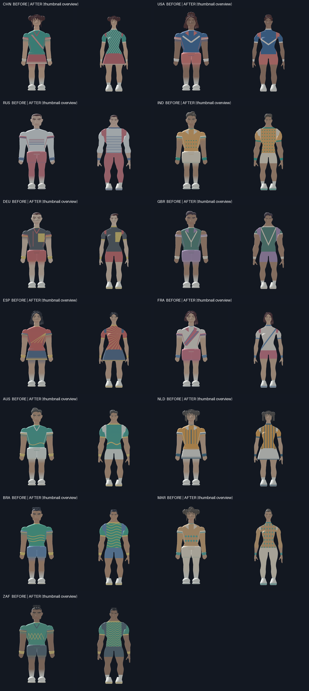
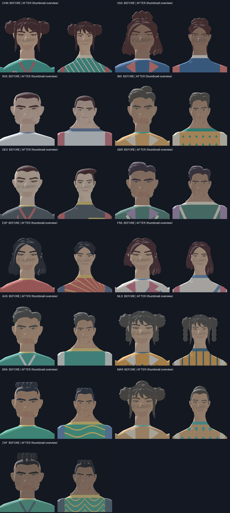
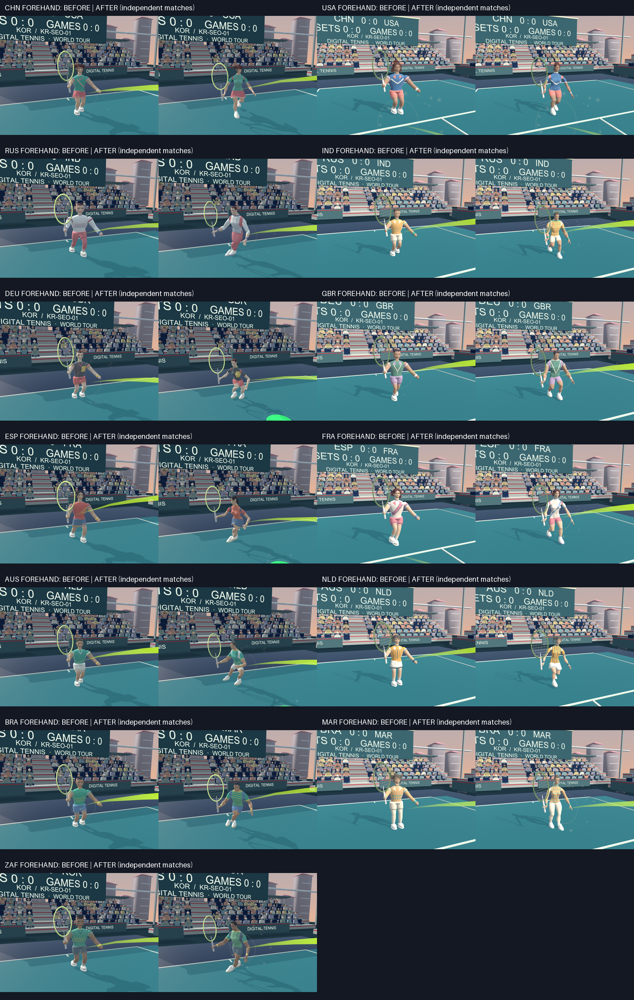

# 전 선수 체형·이동·타격 품질 확장

Baseline: `b3fcbed1188a38982dca4833f6417074d1d6a618` (KOR/JPN improvement, PR19). This change extends the existing production skin path to CHN, USA, RUS, IND, DEU, GBR, ESP, FRA, AUS, NLD, BRA, MAR and ZAF.

All fifteen now consume retained Quaternius CC0 adult full-body topology on the existing 15-bone contact rig. KOR/JPN mesh and body-derivative bytes and their appearance profiles are preserved. Each additional body uses its existing authored shoulder, waist, hip, face and jaw measurements. Facial width/jaw/nose, eye aperture and brow inclination remain individual design choices, with no inference from nationality. FRA retains their exact nonbinary profile and existing female-source face/body continuity.

The fitted garments use the original primary/secondary/accent palette with brush bands (CHN), varsity chevrons (USA), lighting bands and long layers (RUS), textile cells (IND), asymmetric blocks (DEU), vest seams (GBR), fan seams (ESP), fencing wrap (FRA), wave hems (AUS), canal lines (NLD), rhythm waves (BRA), long sleeves and tiles (MAR), and woven contours (ZAF). The shader evaluates these on the same body surface, so there are no separate floating shirt panels. Authored shoes enclose the trimmed source toes, retain colored soles and laces, and have per-profile widths/lengths. Open skorts use the established thigh-following weights.

The retained hair/scalp is fitted in the same coordinate frame as each face. Pony gathering, asymmetric bob shaping and added curls, braids, quiffs and bun details are **project-authored adaptations**, as are sportswear, shoes, tennis contact/IK and recovery. CC0 claims apply to the acquired bodies/hair and locomotion tracks, not original tennis animation or clothing. Runtime mesh hashes, all new body hashes and source/config/license hashes are in `Assets/ThirdParty/Quaternius/{runtime-bindings,body-bindings,provenance}.json`.

## Actual visual inspection

Unity 6000.3.26f1 / Metal rendered the real production `AthleteSkin` meshes. Front, side and close cameras use the existing matched 900×1100 orthographic parameters. BEFORE meshes are extracted byte-for-byte from b3fcbed into isolated temporary Editor assets. Their material mode is explicitly the original legacy mode for the thirteen. AFTER uses the final runtime resources. No scene is regenerated or saved by the review. Neutral captures are **staged art**, separate from real match motion.

The first GPU inspection found floating added quiffs/curls/braids and FRA's mismatched scalp. The final adaptation attaches these details at actual acquired scalp heights, gathers pony hair, uses a fitted scalp for MAR's authored coiled bun, and preserves FRA's source face/body/hair frame. Front/side/face review checked head/neck continuity, shoulder/arm connections, waist/skort fitting, ankles and covered toes. Low-poly surface faceting is visible and disclosed; these are fitted stylized sportswear surfaces, not cloth simulation or realistic scans.

`RosterAthleteEvidence.Before/After` writes unretouched camera PNGs, graphics metadata and mesh hashes to `.work/roster-art-review`. `tools/review-roster-art.py` only pastes originals below labels, without cropping, resizing or retouching them. The portable gallery uses a new `review` subfolder under the requested `outputs/roster-athlete-upgrade` location; existing KOR/JPN galleries are not overwritten.

## Live motion capture boundary

`MotionValidationDriver` accepts opt-in `-dt-motion-pair ID,ID`. It selects both real characters through `PlayerInputAdapter.Press`, then routes ordinary timed serves and return actions through its existing buffered source/router/adapter. It records only accepted contacts and actual moving/serving poses. It retains the original six-stroke, reach/stretch, grip, foot-plant and error guards. The first CHN/USA native run exposed a 74 mm transient grip discrepancy at profile selection; `CharacterPresentation` now runs after the match publishes selection/buffered state, and the CLI observer measures after the final pose. A new PlayMode regression switches all fifteen identities through the adapter and verifies the first presented frame, including mesh identity. Thresholds are unchanged; the failed initial run is retained separately in `.work/roster-motion-before-order-fix`. No ball, score, skill stock or player pose is assigned for a screenshot. The ordinary gameplay path is unchanged when the flag is absent.

Each pair runs an independent match with its actual unchanged balance. Camera parameters match, but trajectories and sampled serve timing can differ. Sixteen sequential camera frames per action include contact, follow-through and recovery. All audio/character/gameplay/rules/effects files use isolated validation overrides, and the validation monitor remains muted. No OS capture, OS input injection or human app interaction is used.

## Verification scope

The production change is visual presentation only. Existing physics/rules/service/scoring/input/AI and network snapshot fields are unchanged. The exact roster, names, ages, genders, narratives, team colors, voices, subtitles and parsed balance values are checked against b3fcbed. The separately attached external IMU and 12-day/three-developer plan remain unchanged. No physical Windows, BLE, two-PC or WAN validation is claimed.

Local camera images, native player/logs and test XML are retained under `.work`/`Builds`; generated evidence is excluded from Git. Reproduction and inspection commands use the local verification venv and Unity 6000.3.26f1. The final source/player/image receipt is `.work/roster-art-review/review.json`.

## 선수별 외형 방향

나이·성별·출신 배경·서사·대사·능력치는 기존 `roster.json`과 CSV를 보존한다. 국가는 배경과 디자인의 맥락이며 개인의 신체나 능력을 일반화하는 근거로 사용하지 않는다. 아래 변화는 기존 페르소나의 의상과 헤어를 스포츠용으로 정리한 것이다.

| 선수 | 기존 개인 설정 | 이번 외형 정리 |
|---|---|---|
| 중국 · 린웨 | 서예가·복식 전술가 | 묶은 땋은 머리, 옥색 상의의 붓선, 스코트 |
| 미국 · 마야 브룩스 | 옥상 로봇 교실 코치 | 컬이 모인 높은 포니테일, 바시티 패널과 회로 맥락의 흰 트림 |
| 러시아 · 니콜라이 소콜로프 | 조명가·인내하는 반격 선수 | 짧은 헤어, 긴소매 훈련 레이어와 빛 띠 |
| 인도 · 아라브 라오 | 직물 엔지니어·지구력 선수 | 웨이브 퀴프, 잘리 격자와 점 무늬 |
| 독일 · 레나 베버 | 자전거 정비사·서브 기술자 | 비대칭 짧은 헤어, 바우하우스 색면과 봉제선 |
| 영국 · 테오 베넷 | 공동 정원 봉사자·네트 선수 | 단정한 사이드 파트, 조끼 형태의 격자 트림 |
| 스페인 · 루시아 세라노 | 도예 수습생·오버헤드 공격수 | 땋은 포니테일, 도자기색 상의와 부채형 선 |
| 프랑스 · 카미유 로랑 | 무대 의상 제작자·기존 논바이너리 정체성 보존 | 비대칭으로 쓸어 넘긴 보브, 펜싱 랩 의상선 |
| 호주 · 카이 모건 | 해안 구조 봉사자·서브 앤드 런 | 바람에 쓸린 웨이브, 파도형 밑단 |
| 네덜란드 · 노르 더프리스 | 운하 엔지니어·와이드 앵글 네트 선수 | 양갈래 땋은 머리, 운하형 세로 패널 |
| 브라질 · 하파엘 코스타 | 공동체 음악 교사·올코트 반격 선수 | 다듬은 컬, 리듬을 표현한 물결 선 |
| 모로코 · 살마 암라니 | 건축가·공간 기억을 활용하는 수비 전략가 | 두피에 맞춘 코일 번, 젤리지 기하와 긴소매·레깅스 |
| 남아공 · 타보 은들로부 | 트레일 가이드·회복 전문가 | 짧은 트위스트, 직조 맥락의 윤곽 무늬 |

## 재현 순서

Unity Editor에서 이 프로젝트를 닫은 뒤 실행한다. 사용자 실행 파일을 덮어쓰지 않고 `Builds/verification/mac`의 별도 검증 번들을 만든다. 모든 실제 실행은 오디오 모니터가 음소거되고 독립된 CSV 복사본을 사용한다.

```sh
python3 -m venv .work/verification-venv
.work/verification-venv/bin/python3 -m pip install -r tools/requirements-verification.txt
bash tools/unity.sh check
bash tools/unity.sh build-verification-mac
.work/verification-venv/bin/python3 -B tools/capture-roster-neutral.py
.work/verification-venv/bin/python3 -B tools/capture-roster-art-motion.py
.work/verification-venv/bin/python3 -B tools/capture-baseline-athlete-motion.py prepare
.work/verification-venv/bin/python3 -B tools/capture-baseline-athlete-motion.py build
.work/verification-venv/bin/python3 -B tools/capture-baseline-athlete-motion.py capture
bash tools/unity.sh test-edit
bash tools/unity.sh test-play
.work/verification-venv/bin/python3 -B tools/reproduce-athlete-provenance.py
```

비교용 복제본은 b3fcbed의 원래 모델·쉐이더·게임·애니메이션 바이트를 보존한다. 공통 CLI 관찰기와 별도 번들 ID만 이식한다. 원래 품질 검사에서 실패한 지표를 새 버전처럼 통과했다고 표시하지 않는다. 두 실행은 실제로 독립된 경기를 하므로 궤적이나 타이밍이 완전히 같은 영상은 아니다.

달리기 자료는 16프레임의 실제 루트 이동 합계 0.15m 이상, 보폭 진행 0.1 이상이며 리셋/순간이동을 제외한다. 멈추는 구간의 보간된 속도만 남은 자료는 거부하고 다시 촬영한다. 서브·포핸드·백핸드는 타격부터 팔로스루와 준비 자세 복귀까지 원본 16장을 보존한다. 여섯 샷 종류와 기존 그립·팔 늘어짐·발 고정 오차 기준을 유지한다.

온라인 회귀는 같은 Mac의 실제 호스트·게스트 두 프로세스와 로컬 서버로 진행한다. 게임/점수는 호스트만 진행하고, 게스트는 버퍼된 위치·타격 종류/시점을 표현하는지 확인한다. Windows 실기·BLE·두 PC/WAN 검증은 포함하지 않는다.

## 비교 화면

아래는 PR에서 빠르게 볼 수 있는 축소 개요다. 전체 해상도의 정면·옆면·얼굴 원본, 16프레임의 실제 이동/서브/포핸드/백핸드 원본, 원본 픽셀을 유지한 전후 비교판과 해시 영수증은 `.work/roster-art-review/index.html`에 남긴다. 정적인 외형용 포즈와 실제 경기 자료를 구분한다.





로우폴리 얼굴 음영, 고정된 손가락 그립, 천 시뮬레이션의 부재는 남아 있다. 이번 범위는 기존 스타일의 비율·연결·의상·이동과 타격 복귀를 15명에게 일관되게 적용하는 것이다.

## 관측한 검증 결과 · 2026-10-17

최종 런타임 코드와 15개 메시 이후 Unity 6000.3.26f1에서 `check`와 격리된 Mono Mac 빌드가 성공했다. 전체 EditMode **169/169**, PlayMode **38/38**이며 실패·건너뜀은 0이다. 새 PlayMode 검사는 어댑터로 15명을 순서대로 선택했을 때 첫 표시 프레임의 메시 ID와 손–라켓 부착을 검증한다.

최종 네이티브 8조합은 모두 통과했다: KOR/JPN, CHN/USA, RUS/IND, DEU/GBR, ESP/FRA, AUS/NLD, BRA/MAR, ZAF/KOR. 합계 617회 실제 접촉·88회 서브, 조합마다 여섯 샷 종류를 기록했다. 모든 달리기 자료의 이동 거리 합계는 0.2295–4.3262m로, 정지 후 속도 보간만 남은 자료를 제외했다.

| 최종 전체 최대값 | 관측값 | 유지한 허용 기준 |
|---|---:|---:|
| 손–라켓 그립 오차 | 0.000000962m | 0.035m 미만 |
| 라켓–공 접촉 오차 | 0.0004373m | 0.035m 미만 |
| 발 고정 위치 오차 | 0.002200m | 0.040m 미만 |
| 프레임당 발 고정 미끄러짐 | 0.0007306m | 0.035m 미만 |
| 팔 늘어짐 비율 | 1.076752 | 1.081 이하 |

정면·옆면·얼굴의 15명 시트와 최종 13명의 이동·서브·포핸드·백핸드 샘플을 직접 이미지로 확인했다. 영국·네덜란드는 수정한 실제 이동 프레임을 원본 크기로 추가 확인했다. 관측한 샘플에서 뚜렷한 팔다리 분리나 노출된 발가락은 보이지 않았다. 이는 표본 검사이며 모든 카메라·포즈에 대한 보증은 아니다. 고정 손가락, 로우폴리 음영과 천 시뮬레이션의 부재는 위 한계로 남는다.

CC0 원본 아카이브·보관 파일·파생 바인딩의 검사, 변조·누락·비정상 웨이트/좌표/쿼터니언을 거부하는 12개 출처 테스트, 원본으로부터 15개 Body와 네 이동 트랙의 바이트 단위 재생성도 통과했다. 체형 비교/기존 두 선수·15명 정체성·CSV·오디오 보존 검사는 별도로 수행한다.

같은 Mac의 실제 두 Unity 프로세스와 형제 `digital-tennis-match-server`로 온라인 회귀도 통과했다. 의도적으로 게스트 연결을 한 번 끊고 epoch 2로 복귀한 뒤 86포인트·세트 2–0 (7–6, 6–0)·승자가 일치했다. 게스트 물리 틱은 0, 호스트는 20,979로 권위를 유지했다. 게스트 위치 20,395회·타격 상태 40,700회 검사와 양쪽 시점/좌우 이동 검사에서 오류 0, 두 클라이언트 런타임 오류도 0이었다. 보고서는 `.work/roster-online/combined.json`이다.

최종 로컬 검증 및 공개 PR 전달 순서:

```sh
node tools/verify-online.mjs --server-repo ../digital-tennis-match-server --player 'Builds/verification/mac/DigitalTennis.app/Contents/MacOS/Digital Tennis' --out .work/roster-online --offscreen --exercise-reconnect
# 새 소스/.meta와 문서만 stage한 뒤 실제 XML을 현재 소스 목록에 연결한다.
.work/verification-venv/bin/python3 -B tools/record-athlete-regression.py
.work/verification-venv/bin/python3 -B tools/review-roster-art.py --motion --publish <output-directory>
# 커밋·push·초안 PR 생성 이후 실제 원격 상태까지 읽어 검사한다.
.work/verification-venv/bin/python3 -B tools/record-athlete-delivery.py
.work/verification-venv/bin/python3 -B -m unittest discover -s tools -p test_athlete_current.py -v
```

`--reuse-composites`는 이미 기록한 모든 원본/비교 이미지와 생산 소스의 해시가 그대로일 때만 보고서·문서 연결을 갱신한다. 이미지나 Assets/Packages/ProjectSettings가 달라졌으면 재사용을 거부한다. 빌드·`.work`·실행 로그는 Git에서 제외하고, PR에는 위 세 축소 비교 PNG와 재현 도구·문서·실제 게임 소스만 포함한다.
