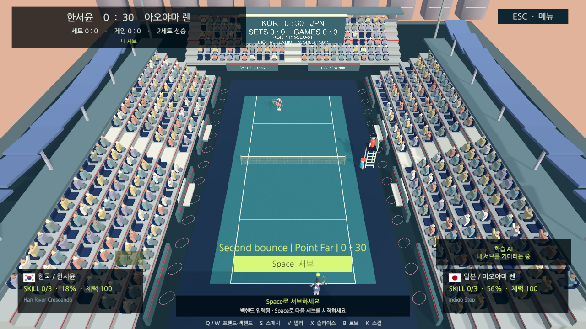
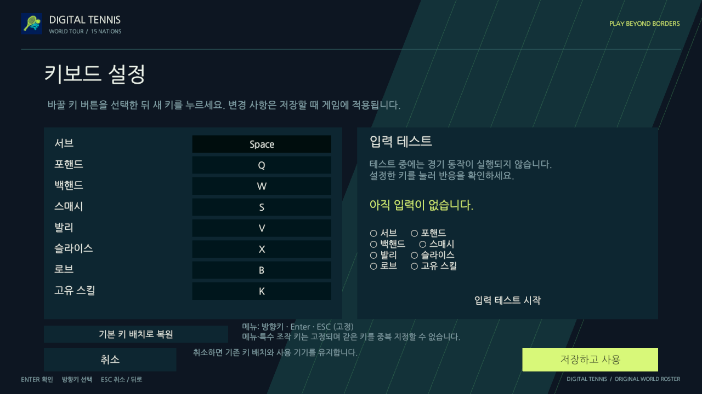
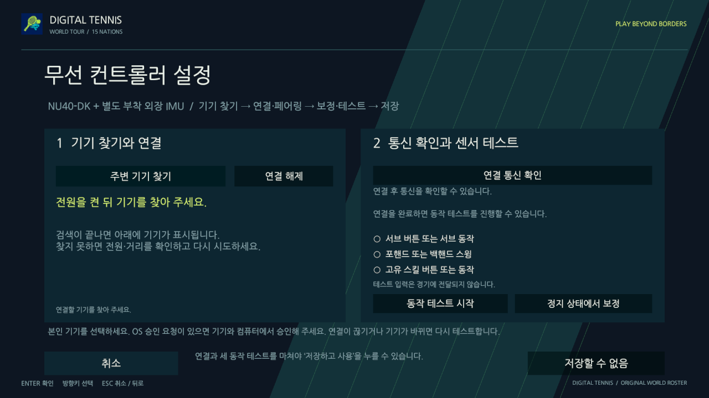
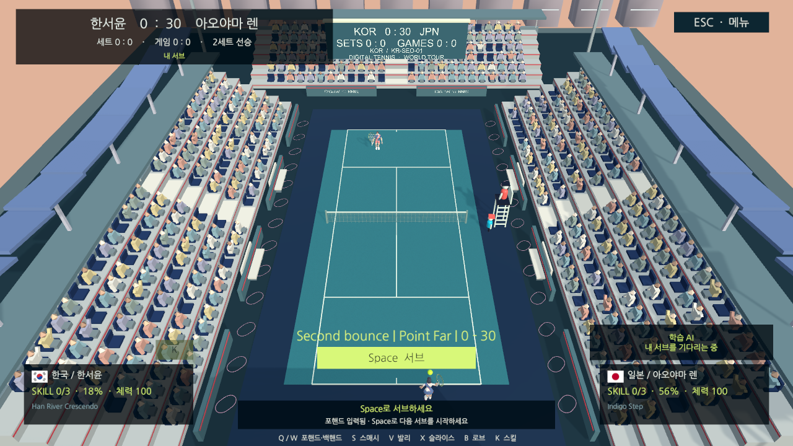

# 물리 스킬 연결·AI 실제 경기 평가·배포 검증

2026-10-20. 제품은 NU40-DK + 별도 외장 IMU이며 NU54는 임시 센서 없는 시험 타깃이다. 이번 작업에서 flash·추가 버튼 조작·실물 IMU 검증은 하지 않았다.

## 변경한 동작

센서 입력을 기존 `GestureSkillInputSource`로 감싸고, 실제v3 MOTION6종을15명 고유CSV 패턴으로 연결했다. 재고가 있을 때 정상 게임에서만 인식하며 완성하는 마지막 입력만Skill이다. 버튼바인딩은 실제IMU 토큰으로 쓰지 않고, 버튼4/K는 기존Skill 요청을 유지한다. 메뉴·설정·타이핑·정지·득점후·선수/소스변경·단절은 부분패턴을 버린다. 재고/점수/공을 입력원에서 직접 수정하지 않는다.

`Balance/gestures.csv`의 패턴/간격/총시간/cooldown을 외부CSV로 바꾸고 안전한F5 또는 앱재시작으로 반영한다. 잘못된 재로드는 직전설정을 유지한다. [역할·CSV·수정 지점](physical-controller-input.md)을 따른다. 실제 손동작의 편의성과 인식률은 외장IMU 실기로 확인해야 한다.

## 검증 결과

- Unity6000.3.26f1: EditMode207개, PlayMode46개 통과. 일반Play에서제외한GPU포인터1개와별도AI평가1개(9내부사례)는각각통과했다.
- 실제v3 패킷→SDK→보정/테스트/저장→센서source→KOR패턴→일반Skill 경로에서재고1개소비와재전송중복방지를확인했다. 해당패킷검사의재고는명시적사전조건이며, 별도실제랠리검사는공격으로획득한재고를소비한다.
- AI는 실제SinglePlayerCourt, KOR/JPN,3난이도×3시드에서2서비스게임씩106포인트를진행했다. 실제리턴/학습판단157회, 타격거부0회. 하13/40(32.5%),중29/41(70.7%),상24/25(96.0%)는고정가상입력에대한점유율이며사람승률이아니다.
- 이코호트는짧은좌/우코너3/5만선택했다. 다른대진/장기전술/전체경기학습일반화의증거로사용하지않는다. 이결과에맞춰CSV계수나모델가중치를임의로조절하지않았다.
- 최초묶음평가의180초기본제한실패는보존했다. 전용제한1200초·사례별중간저장을추가해9사례를재실행했고, 각경기100초제한·타격/점수검사는유지했다.

정확한커밋·모델/CSV/XML 해시와한계는 [검증JSON](evidence/software-followup/validation.json), AI저장소의 `Models/match-scenes.json`과 `match-evaluation.json`에남긴다. 런타임은e4d5e78, 보완한평가코드는0393f1d이며후속문서커밋은게임로직을바꾸지않는다.

## 최신 main 배포와 일반 창

main `b28a668e4b7c86ff5d0709c44311ef68a0d983b4`를깨끗한소스에서Mac/Windows 비개발빌드했다. Development/AllowDebugging=false, 네이티브helper·Apache/외부자산고지·Macadhoc서명·ZIP·SHA256을검사했다. Windows는교차빌드이며실제PC검수가남는다. DeveloperID공증된배포판은아니다.

일반Mac창에서네이티브키보드로시작→선수/상대/코트→대진→경기, 서브2회·AI리턴2회·2포인트·다음서브와일시정지/컨트롤러화면을확인했다. 키보드상세에는연결기능이없고, 무선상세는찾기/연결/테스트후저장순서를안내하며미연결저장을막는다. 설정을변경해저장하거나보드를추가조작하지않았다. 기록한런타임예외는0이다.

재현: `bash tools/unity.sh check`, `test-edit`, `test-play`, `test-mouse`, `test-ai-evaluation`. AI집계도구는별도AI저장소의 `tools/evaluate-match-report.py`다. 배포는커밋이깨끗한상태에서 `release-mac`/`release-windows`와 `tools/package-release.py`를사용한다. 개선후보는PR검토전까지main에반영된것으로표시하지않는다.

## 개선 후보 비개발 빌드

소스 `fa6736e25506a4bd1800605e313217e3b4a7c930`의 Mac·Windows 비개발 빌드와 ZIP·SHA256을 생성했다. 후보도 일반 Mac 창에서 네이티브 키보드로 시작·선택·서브2회·학습AI리턴2회·2포인트·다음 서브 대기를 확인했고, 기록한 런타임 예외는0이다. Windows는 교차 빌드다. 이 실행과 배포 뒤 추가한 검증 문서 커밋은 게임 코드/CSV/패키지를 바꾸지 않는다.

