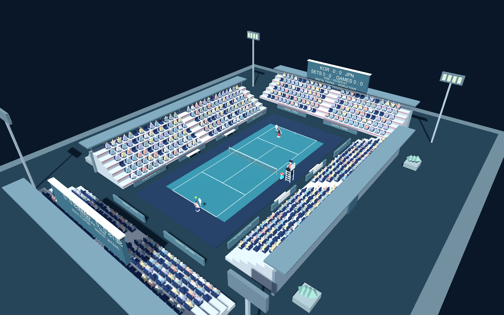
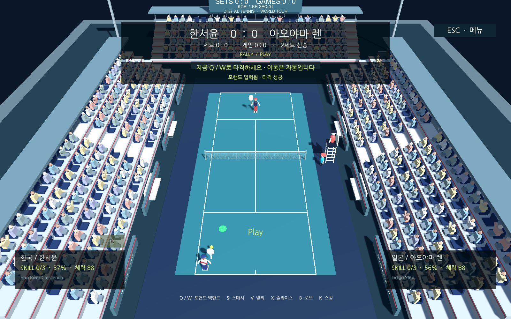

# 관중석이 있는 경기장

> 이 문서는 이전 설계/구현 기록입니다. 2026-10-16의 실제 선수 모델·15개 건축 테마·음원·외부 로더·설정은 [게임 완성도 개선](game-polish.md), 최신 증거는 [검증 결과](polish-validation.md)를 참고하세요.

`SinglePlayerCourt`와 `MatchCourt`의 추상적인 코트 뒤 장식을 실제 경기장 형태의 3D 배경으로 교체했습니다. 메뉴에서 선택한 코트로 1인·연습·온라인 경기를 시작하면 같은 경기장 구성을 사용합니다. 독립 공 실험 씬 `DevelopmentCourt`는 유지합니다.



전체 구성 확인용으로 게임 카메라를 잠시 높은 위치로 옮겨 저장한 화면입니다. 기본 플레이 카메라는 아래 랠리 화면과 같습니다.



## 추가한 배경

| 구성 | 현재 구현 |
| --- | --- |
| 관중석 | 코트 네 방향, 각 6단의 계단식 스탠드, 624개 좌석, 중앙 통로·등받이·난간·후면 지붕 |
| 관중 | 502명의 원본 로폴리 모델, 여러 의상·피부색과 일부 응원 자세 |
| 시설 | 벤치, 광고판, 출입구 표현, 외곽 보행 공간·식재, 조명탑 4개 |
| 전광판 | 양쪽 엔드에 배치, 실제 포인트·게임·세트와 선수 국가 ID 표시 |
| 국가 테마 | 기존 15개 코트의 바닥·하늘 색과 연동한 좌석·띠 장식·외곽 색, 국가 ID·코트 코드 표시 |

국가별로 공통 경기장 구조를 사용하며 배색과 표기를 바꿉니다. 15개 국가의 전용 건축물을 각각 새로 제작한 것은 아닙니다. 관중은 현재 고정된 착석·응원 자세이며 움직이는 응원, 관중 음성·BGM, 고해상도 선수 모델은 후속 작업입니다. 조명탑은 발광 패널을 표현하며 별도의 실시간 조명 네 개를 추가하지 않습니다.

## 경기 코드와의 경계

- 배경에는 Collider, Rigidbody와 입력 처리가 없습니다. 경기 공간과 선수의 이동 여유 공간 바깥에 배치합니다.
- `TennisStadium`은 약 0.15초마다 기존 점수 상태를 읽어 표시합니다. 온라인 손님은 `PresentedState`를 읽고, 호스트만 기존 규칙·물리를 계산합니다.
- 카메라·타격 판정·CSV 밸런스·세트 규칙은 기존 구현을 사용합니다. 전광판이 득점을 발생시키지 않습니다.
- 배경 메시 9개를 재질별로 합쳐 저장합니다(110,976 정점·53,432 삼각형). 관중 502명에 각각 GameObject·Animator·물리를 만들지 않습니다. 관중의 그림자 투사도 끕니다.
- 국가별 색은 `MaterialPropertyBlock`으로 적용합니다. 국가 선택 때마다 배경 재질을 복제하거나 메시를 생성하지 않습니다.

외부에서 내려받은 모델이나 유료 에셋은 사용하지 않았습니다. 생성기·셰이더·메시와 `.meta`가 저장소의 원본 자산입니다. 관중 메시가 비교적 크므로 향후 목표 Windows PC에서 프레임 시간과 그림자 비용을 추가 측정합니다.

## 수정할 위치

| 파일 | 책임 |
| --- | --- |
| `Assets/Scripts/Editor/StadiumProjectSetup.cs` | Editor API로 좌석·관중·시설 메시와 씬 오브젝트 생성, 관중/좌석 수와 충돌체 검사 |
| `Assets/Art/Stadium/` | 두 경기 씬이 공유하는 메시·재질, 약 7.3 MB |
| `Assets/Shaders/StadiumVertexLit.shader` | Built-in용 정점 색·조명 셰이더 |
| `Assets/Scripts/Runtime/TennisStadium.cs` | 실행 시 배경 참조 연결, 국가별 색과 전광판 갱신 |
| `Assets/Scripts/Runtime/NationalCourtView.cs` | 기존 코트 테마를 경기장에 전달, 예전 임시 장식 숨김 |
| `Assets/Scripts/Runtime/StadiumValidationDriver.cs` | 명시적인 CLI 옵션이 있을 때만 화면·랠리 검증 |

생성된 자식 이름 `Individual Stadium Seats`, `National Accent Bands`, `Outer Plaza`, `Live Score -1/1`, `Venue Name -1/1`은 런타임 연결에 사용합니다. 이름을 바꿀 때 생성기와 `TennisStadium`을 함께 수정합니다. 씬의 참조 구조·메시는 Unity Editor API로 저장하고 GUID를 유지합니다. 기존 경기장이 있으면 `setup`은 중복 생성하지 않으므로, 배치 변경은 기존 오브젝트를 수정하는 Editor 작업을 추가해 적용합니다.

```bash
bash tools/unity.sh setup       # 경기장이 없는 경기 씬에 추가
bash tools/unity.sh check       # 컴파일·씬 구성과 배경 충돌체 검사
bash tools/unity.sh test-front  # 메뉴·선택·입력·랠리 회귀 검사
bash tools/unity.sh build-mac
```

## Mac 실행 검증

2026-10-16, Unity 6000.3.26f1에서 다음을 확인했습니다.

- 프로젝트 `check`, Mac 실행 파일 빌드, FrontEnd PlayMode 4개 통과.
- 실제 Mac 게임 프로세스에서 15개 국가 × Near/Far 두 시점, 총 30개 화면 저장. 별도 전체 조감도는 구성 확인용입니다.
- 별도 실행에서 시작 메뉴→한국 선수→일본 상대→한국 코트→경기로 실제 UI 콜백을 통해 진입하고 HUD 화면을 저장했습니다.
- 두 실행 모두 실제 어댑터 입력과 AI로 사용자 3회·AI 4회 타격, 1포인트 득점과 다음 서브 대기를 확인했습니다. 배경 충돌체 0개, 런타임 오류 0개입니다.

전광판 상단은 기본 경기 카메라 구도 밖으로 일부 나갑니다. 경기 중에는 기존 HUD가 전체 점수를 표시하며 전체 전광판은 조감도에서 확인할 수 있습니다.

검증 입력은 일반 `PlayerInputAdapter` 경로를 사용하며 점수나 공 위치를 쓰지 않습니다. 국가·양쪽 시점·조감도 이미지는 배경 확인용으로 준비한 화면이며, `live-rally`는 실제 타격이 진행 중인 화면입니다. 이번 화면 검증은 Mac 잠금을 유지하고 GPU 게임 카메라와 게임 HUD만 PNG로 저장했습니다. 운영체제 화면 캡처나 물리 키보드 수동 조작 검증은 수행하지 않았습니다. Windows와 실제 외부 네트워크 검증도 별도입니다.

재현 시 검증 전용 CSV를 복사해 사용합니다. 아래 실행은 게임 창 대신 게임 내부 화면을 저장하고 종료합니다.

```bash
project_dir="$PWD"
preview_dir="$project_dir/.work/stadium-preview"
mkdir -p "$preview_dir"
cp Assets/StreamingAssets/Balance/gameplay.csv "$preview_dir/gameplay.csv"
cp Assets/StreamingAssets/Balance/characters.csv "$preview_dir/characters.csv"
cp Assets/StreamingAssets/Balance/rules.csv "$preview_dir/rules.csv"
cp Assets/StreamingAssets/Effects/effects.csv "$preview_dir/effects.csv"
"Builds/mac/DigitalTennis.app/Contents/MacOS/Digital Tennis" \
  -batchmode -screen-fullscreen 0 -screen-width 1600 -screen-height 1000 \
  -dt-stadium-verify "$preview_dir" \
  -dt-gameplay-file "$preview_dir/gameplay.csv" \
  -dt-balance-file "$preview_dir/characters.csv" \
  -dt-rules-file "$preview_dir/rules.csv" \
  -dt-effects-file "$preview_dir/effects.csv" \
  -logFile "$preview_dir/player.log"
```

`-dt-stadium-front`를 함께 전달하면 30개 테마 화면 대신 실제 시작 메뉴와 경기 HUD를 검증합니다. 각 실행의 `result.json`에서 통과 여부·오류·타격·득점·서브 준비를 확인합니다. CLI 옵션 없이 실행하면 검증 소스는 비활성화되고 기존 키보드 입력을 사용합니다. 개발용 빌드 캐시를 완전히 갱신해야 할 때는 Editor의 `ProjectSetup.BuildMac` 호출에 `-dt-clean-build`를 명시할 수 있으며 기본 빌드 방식은 유지됩니다.
